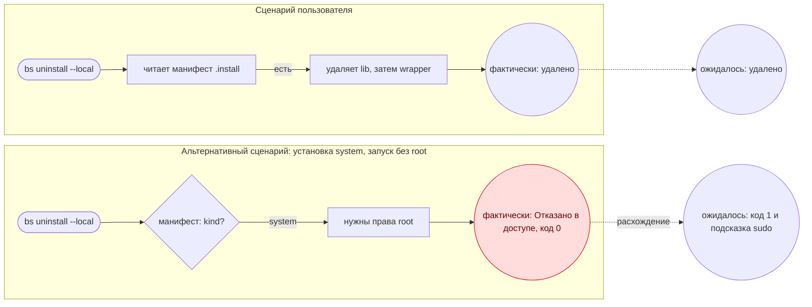

# Схема сценария / Scenario diagram

Для каждой карточки, где есть хотя бы один альтернативный сценарий или полусценарий, рисуем схему в две дорожки: **сценарий пользователя** (основной) и **альтернативный**; в конце каждой — «фактически» и «ожидалось», расхождение отмечено красным. Нотация (вход, действие, решение, процесс системы, конец, подпись стрелки по условию) — по идее навыка *user-flow-diagram* ([owl-listener/designer-skills](https://github.com/owl-listener/designer-skills), MIT).
For every card with at least one alternative scenario or half-scenario, draw a two-lane diagram: the **user scenario** (main) and the **alternative** one; each ends with "actual" and "expected", the mismatch is red. Notation follows the idea of *user-flow-diagram*.

## Правила / Rules

1. Один поток на одну цель; сначала основной путь, затем ветви и ошибки.
2. Каждая стрелка подписана условием (`root`, `нет TTY`, `Ctrl-C`, `rm не удался`).
3. Решение — ромб `{}`; действие пользователя — скруглённый `([ ])`; процесс системы — прямоугольник `[ ]`; конец — `(( ))`.
4. В конце дорожки два узла: **фактически** и **ожидалось**; при расхождении — класс `bad`.
5. Не больше ~12 узлов на схему; иначе разбить по частям карточки.

## Шаблон Mermaid / Mermaid template

Пример ниже — иллюстрация формы, а не результат прогона. / The example below illustrates the form; it is not a run result.



## Где показать / Where to show

- В отчёте — блок ` ```mermaid `. Если в сессии есть средство отрисовки (виджет, artifact), показать схему там.
- Не придумывать «фактически»: узел заполняется только после прогона в песочнице (протокол, шаги 0 и 4).
