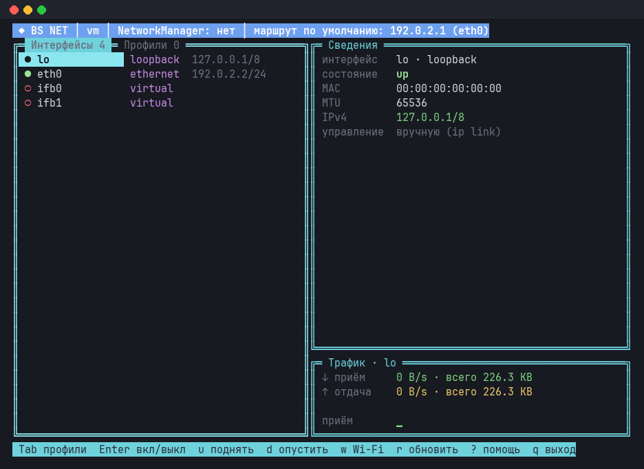
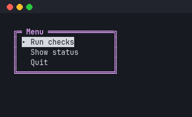
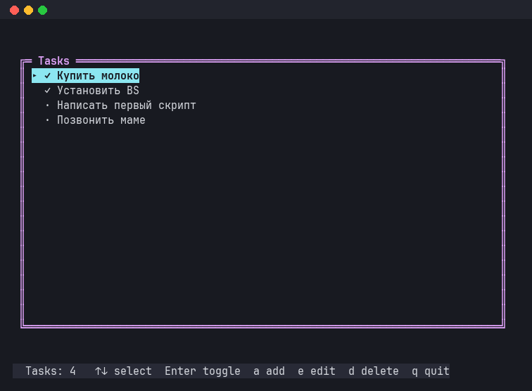
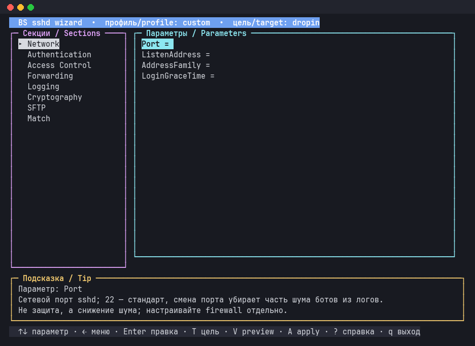

# 🐚 BS Framework

> 🇬🇧 English version · 🇷🇺 [Русская версия](README.md)

**BS is a modular framework and standard library for shell scripts.**
Write your script, `load` the modules you need, and the framework does
the rest.

<p align="center">
  
</p>

## ✨ Why BS

- 📦 **Module loader** with dependency resolution: `load "lib/io/streams"` pulls in everything it needs
- 📝 **Logging** and 🛡️ **error handling** out of the box
- ⚙️ **Script parameters in one declaration**: validation, `--help` and completion for free
- 🖥️ **Pure bash TUI**: windows, menus, modals, mouse
- 🧰 **100+ modules**: files, processes, network, hardware, services, HTTP, LLM, Kubernetes
- 📦 **`bs build`**: your script and the framework in one file that runs without installing anything
- 🐚 **POSIX sh kernel**, standard library in Bash 4.2+
- 🎯 **Zero external dependencies** and one code style

## 🚀 Quick start

```bash
git clone https://github.com/Igormm/bs.git && cd bs

./bs run examples/hello.sh     # your first script
./bs repl                      # interactive console
./bs doctor                    # check that everything is in place
```

Like it? Put the `bs` command in your `PATH`:

```bash
./install.sh --local           # into ~/.local, no sudo
```

## 👋 Examples

### Hello, world

```bash
#!/usr/bin/env bs

load "lib/io/streams"

io::streams::print "hello from BS $(bs::version::get)"
```

```console
$ bs run examples/hello.sh
hello from BS 0.19.0
```

### 📝 Logging without boilerplate

The logger and checks like `is::file` are available right away, no `load` needed:

```bash
#!/usr/bin/env bs

log::info "Starting the backup"
if is::file "/etc/hostname"; then
    log::success "The file is there, ready to copy"
else
    log::warn "No such file, skipping"
fi
```

```console
[2026-11-11 08:06:35] INFO  Starting the backup
[2026-11-11 08:06:35] SUCCESS The file is there, ready to copy
```

### ⚙️ A script with parameters

Declare the parameters once; BS does the validation, error messages and
`--help`. Read values by meaning: `args::get 1` (the first command word)
and `args::flag_get name` (the value of `--name`).

```bash
#!/usr/bin/env bs

load "core/args"
load "lib/io/streams"

main() {
    args::level 1 hello goodbye           # first word: hello or goodbye
    args::flag name value world           # --name NAME, default world
    args::flag loud                       # --loud, no value
    args::required 1
    args::require "$@"                    # an error or --help exits here

    local command name msg
    command="$(args::get 1)"              # hello | goodbye
    name="$(args::flag_get name)"         # the --name value or world

    case "${command}" in
        hello)   msg="Hello, ${name}!" ;;
        goodbye) msg="Goodbye, ${name}!" ;;
    esac
    if args::flag_is_set loud; then
        msg="${msg^^}"
    fi
    io::streams::print "${msg}"
}

main "$@"
```

```console
$ bs run examples/greet.sh hello --name Bob
Hello, Bob!
$ bs run examples/greet.sh hello --name Bob --loud
HELLO, BOB!
$ bs run examples/greet.sh --help
Usage: bs [flags] [hello|goodbye]
...
```

The full version with `--help` descriptions: [examples/greet.sh](examples/greet.sh).

### 🎛️ A terminal menu



`↑↓` to select, `Enter` to run, `q` to quit. The full example with the
key loop: [examples/menu.sh](examples/menu.sh).

```bash
load "lib/tui/tui"

main() {
    local -a items=("Run checks" "Show status" "Quit")
    local -i sel=0

    # full-screen mode
    tui::init
    # menu at (2, 2), item sel selected
    tui::menu 2 2 items "${sel}" "Menu"
    tui::render
    # wait for a key: it lands in $TUI_KEY
    tui::key_read
    # ...
}
```

<br clear="right">

## 🖼️ What you can build with BS

All of this lives in [examples/](examples/) and runs with one command.

| | |
|---|---|
| ✅ **Todo list** `examples/todo.sh`<br>Windows, modals, a task file. |  |
| 🔐 **sshd setup wizard** `examples/sshd_wizard.sh --dry-run`<br>Profiles, a tip for every option, safe apply. |  |
| 🌐 **Network** `examples/netconn.sh`<br>Interfaces, addresses, live traffic. |  |

More examples:

- 🛡️ `fail2ban_wizard.sh`, `ntp_wizard.sh`, `locale_wizard.sh`: system setup wizards
- 🔑 `openbao_wizard.sh`: OpenBao installer, [details](documentation/en/03-modules/system-openbao.md)
- 🛰️ `vpn.sh`: a sing-box and Xray VPN client with a TUI, [details](documentation/en/03-modules/network-vpn.md)
- 💓 `pulse.sh`, `sysdiag.sh`: a quick look at the host
- 🌍 `http_example.sh`, `llm_example.sh`, `k8s_example.sh`: integrations

## 🧰 The `bs` tool

| Command | What it does |
|---|---|
| `bs run script.sh` | run a script (or put `#!/usr/bin/env bs` at the top) |
| `bs repl` | console with the kernel loaded, `:list`, `:doc`, `:info` |
| `bs calc '2 3 4 * +'` | RPN calculator |
| `bs list` | list modules |
| `bs build script.sh` | one self-contained file that runs without BS installed |
| `bs doctor` | integrity check |
| `bs update` | update installed copies |
| `bs where` | find every BS install on the machine |

## 📦 Installation

```bash
./install.sh --local      # ~/.local/bin/bs, no sudo
sudo ./install.sh         # /usr/local/bin/bs, for everyone
```

The installer copies the framework, so you can delete the clone afterwards.
Install kinds, updating and removal are in
[documentation/en/install.md](documentation/en/install.md).

**Requirements:** Linux and Bash 4.2+ (CI checks 4.4–5.x on ubuntu, debian
and almalinux 8–9). You can start `bs` from any shell: it finds bash itself.

## 🗂️ Layout

```
bs              CLI and interpreter
bootstrap/      module loader
core/           kernel: args, logger, errorhandler, utils, lang …
lib/            standard library: io, tui, system, network, integration …
examples/       examples
tests/          tests
documentation/  docs in Russian and English
```

## 🧪 Tests

```bash
bash tests/runalltests.sh          # full suite
bash tests/validateshellcheck.sh   # ShellCheck
```

## 📚 Documentation

- 🏁 [Getting started](documentation/en/01-getting-started/README.md)
- ✍️ [Your first script, step by step](documentation/en/05-tutorials/first-script.md)
- 🏗️ [Architecture](documentation/en/02-core-concepts/architecture.md)
- 🧩 [Modules overview](documentation/en/03-modules/lib-modules-overview.md)
- 📖 [Core API reference](documentation/en/04-api-reference/core-api.md)
- 🎨 [Code style](documentation/en/code-style-guide.md)
- 🇷🇺 [Документация на русском](documentation/ru/README.md)

## 💡 Principles

- **Bash is everywhere:** nothing to install.
- **It's bash, not a new language:** the whole bash ecosystem stays open, `bash -x` works.
- **No magic:** every line reads as plain bash.
- **Ops first:** cron, CI, Docker, one file via `bs build`.
- **Honest boundaries:** heavy data work goes to jq or Go over JSON.

## 📄 License

MIT, see [LICENSE](LICENSE).
