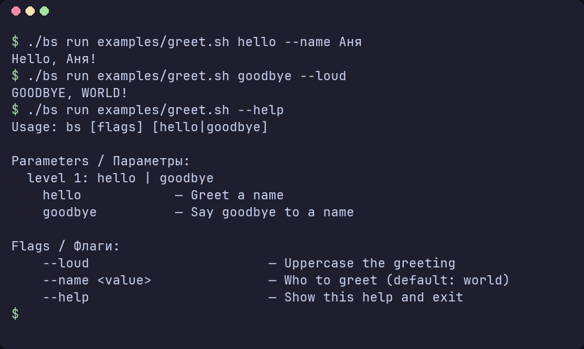

# 🐚 BS — фреймворк для shell-скриптов

🇬🇧 [English version](README.en.md)

[](https://github.com/Igormm/bs/actions/workflows/ci.yml)


[](LICENSE)

**BS** — модульный фреймворк и стандартная библиотека для shell-скриптов.
Вы пишете обычный скрипт, подключаете нужные модули одной строкой `load`,
а разбор аргументов, справку, логи, обработку ошибок и даже текстовый
интерфейс берёт на себя фреймворк.



## ✨ Что внутри

- 📦 **Модули по требованию**: `load "lib/io/streams"`, зависимости
  подтягиваются сами, повторная загрузка и циклы исключены.
- 🎛️ **Аргументы без боли**: описали команды и флаги один раз, получили
  проверку, понятные ошибки, `--help` и автодополнение.
- 📝 **Логи и ошибки из коробки**: уровни, цвета, JSON-формат, стек очистки
  при выходе.
- 🖥️ **TUI на чистом bash**: окна, кнопки, меню, модальные окна, мышь.
- 🧰 **Стандартная библиотека**: файлы, процессы, сеть, железо, HTTP, LLM,
  Kubernetes, UUID, CSV и ещё больше 80 модулей.
- 🐚 **Работает везде**: ядро написано на POSIX sh, библиотека на Bash 4.2+,
  внешних зависимостей нет.

## 🚀 Быстрый старт

```bash
git clone https://github.com/Igormm/bs.git && cd bs

./bs doctor                  # 🩺 всё ли на месте
./bs run examples/hello.sh   # 👋 первый скрипт
./bs repl                    # 💬 интерактивная консоль
```

Хотите команду `bs` в `PATH`? Смотрите раздел [Установка](#-установка).

## 👋 Первый скрипт

`examples/hello.sh`: строка `load` подключает модуль вывода, дальше обычный
bash.

```bash
#!/usr/bin/env bs
# shellcheck shell=bash

load "lib/io/streams"

io::streams::print "hello from BS $(bs::version::get)"
```

```bash
./bs run examples/hello.sh
```

## 🎛️ Скрипт с параметрами

`examples/greet.sh` здоровается или прощается. Мы описываем, какие слова и
флаги скрипт понимает, а проверку и справку фреймворк делает сам.

```bash
#!/usr/bin/env bs
# shellcheck shell=bash

load "core/args"
load "lib/io/streams"

main() {
    args::level 1 hello goodbye
    args::describe hello "Greet a name"
    args::describe goodbye "Say goodbye to a name"
    args::flag name value world
    args::flag loud
    args::flag_describe name "Who to greet"
    args::flag_describe loud "Uppercase the greeting"
    args::required 1
    args::require "$@"

    local -r command="$(args::param 1)"
    local -r name="$(args::flag_get name)"
    local msg
    case "${command}" in
        hello)   msg="Hello, ${name}!" ;;
        goodbye) msg="Goodbye, ${name}!" ;;
    esac
    args::flag_is_set loud && msg="${msg^^}"
    io::streams::print "${msg}"
}

main "$@"
```

Что здесь происходит:

| Строка | Смысл |
|---|---|
| `args::level 1 hello goodbye` | первое слово после имени скрипта: `hello` или `goodbye` |
| `args::flag name value world` | флаг `--name` со значением, по умолчанию `world` |
| `args::flag loud` | флаг-переключатель `--loud` без значения |
| `args::require "$@"` | проверить аргументы; при ошибке показать причину и справку |
| `args::param 1` | первое слово, которое передали (счёт с 1, как у `$1`) |
| `args::flag_get name` | значение `--name` или дефолт `world` |
| `args::flag_is_set loud` | передали ли `--loud` |

```bash
./bs run examples/greet.sh hello --name Аня      # Hello, Аня!
./bs run examples/greet.sh goodbye --loud        # GOODBYE, WORLD!
./bs run examples/greet.sh --help                # справка из того же описания
```

🔎 Подробнее: [модуль args](documentation/ru/03-modules/args.md).

## 🖥️ Текстовый интерфейс

`examples/todo.sh` — список дел на `lib/tui/app`: окна, клавиши и
модальные окна берёт на себя фреймворк, задачи хранятся в `~/.todo.tsv`.


```bash
./bs run examples/todo.sh
```

⌨️ `↑↓` выбор · `Enter` отметить · `a` добавить · `e` изменить · `d` удалить · `q` выход

Окно с кнопкой укладывается в несколько строк (`examples/app_demo.sh`):

```bash
load "lib/tui/app"

main() {
    tui::app::window main "Hello BS" 2 2 30 9
    tui::app::button main greet "Say hello" 3 4
    tui::app::on greet app::say_hello
    tui::app::statusbar "Tab / arrows — next button, Enter — press, q — quit"
    tui::app::run
}
```

## 🧪 Что ещё попробовать

| Пример | Что покажет |
|---|---|
| `./bs run examples/pulse.sh` | 💓 паспорт машины: дистрибутив, bash, процессор, память |
| `./bs run examples/menu.sh` | 📋 простое меню на стрелках |
| `./bs calc '2 3 4 * +'` | 🧮 калькулятор в обратной польской записи |
| `./bs run examples/sysdiag.sh quick` | 🔍 быстрая диагностика системы |
| `./bs list` | 📚 все модули фреймворка |

Для администраторов есть полноэкранные мастера настройки:
[sshd](examples/sshd_wizard.sh) (`--dry-run` ничего не меняет),
[fail2ban](examples/fail2ban_wizard.sh), [OpenBao](documentation/ru/03-modules/system-openbao.md)
и [VPN-клиент](documentation/ru/03-modules/network-vpn.md) на sing-box и Xray.
Все примеры с описанием: [examples/](examples/README.md).

## 🛠️ Команды `bs`

| Команда | Зачем |
|---|---|
| `bs run script.sh` | запустить скрипт; или `#!/usr/bin/env bs` в первой строке |
| `bs repl` | консоль с загруженным ядром: `load`, история, `:doc`, `:list` |
| `bs calc` | RPN-калькулятор: одной строкой или интерактивно |
| `bs build script.sh` | 📦 собрать скрипт в один файл, который работает без установки BS |
| `bs doctor` | проверить целостность фреймворка |
| `bs update` | обновить установленные копии из репозитория или с GitHub |
| `bs where` | найти все следы BS на машине и подсказать, что поправить |

## 📥 Установка

BS работает прямо из папки репозитория. Для постоянной работы удобно
поставить команду `bs` в `PATH`:

```bash
./install.sh --local     # в ~/.local, без sudo
sudo ./install.sh        # в /usr/local для всех пользователей
```

Установщик копирует фреймворк, так что после установки папку с
репозиторием можно удалить.

| Режим | Куда | Команда `bs` |
|---|---|---|
| `--local` | `~/.local/lib/bs` | `~/.local/bin/bs` |
| системный | `/usr/local/lib/bs` | `/usr/local/bin/bs` |
| свой путь | `$LIB_DIR/bs` | `$BIN_DIR/bs` |

Один файл без установки:

```bash
./bs build examples/sysdiag.sh            # → examples/sysdiag.standalone.sh
./examples/sysdiag.standalone.sh quick    # работает там, где есть bash 4.2+
```

Обновление, удаление и подробности: [documentation/ru/install.md](documentation/ru/install.md).

## 📋 Требования

- 🐧 Linux (macOS поддерживается частично)
- 🐚 Bash 4.2+ для стандартной библиотеки; CI проверяет bash 4.4–5.x на
  ubuntu, debian и almalinux 8–9
- Запускать `bs` и `install.sh` можно из любой оболочки: они сами найдут
  bash

## 🗂️ Устройство проекта

```
bs              # CLI и интерпретатор скриптов
bootstrap/      # загрузчик модулей
core/           # ядро на POSIX sh: аргументы, логи, ошибки, утилиты
lib/            # стандартная библиотека: io, tui, system, network, data, ...
examples/       # готовые примеры
tests/          # тест-фреймворк и наборы тестов
documentation/  # документация: ru/ и en/
```

## ✅ Тесты

```bash
bash tests/runalltests.sh          # все тесты
bash tests/validatesyntax.sh       # синтаксис
bash tests/validateshellcheck.sh   # ShellCheck
```

## 📚 Документация

- 🏁 [Начало работы](documentation/ru/01-getting-started/README.md)
- ✍️ [Первый скрипт: пошаговый урок](documentation/ru/05-tutorials/first-script.md)
- 🏗️ [Архитектура](documentation/ru/02-core-concepts/architecture.md)
- 🎛️ [Аргументы `core/args`](documentation/ru/03-modules/args.md)
- 🤫 [Идиомы тишины `utils::quiet*`](documentation/ru/03-modules/core-utils.md)
- 🌐 [HTTP, LLM, Kubernetes](documentation/ru/03-modules/integration-http.md)
- 🎨 [Стиль кода](documentation/ru/code-style-guide.md)
- 🤖 [Правила для ИИ-агентов](AGENTS.md)
- 📖 [Вся документация](documentation/ru/README.md)

## 💡 Принципы

- 🌍 **Работает везде.** Bash есть почти на любой машине: ничего не нужно
  ставить, внешних зависимостей нет.
- 🤝 **Это всё ещё bash.** BS добавляет соглашения, а не новый язык: любой
  bash-код и любые утилиты остаются под рукой.
- 🔍 **Без магии.** Каждая строка читается и отлаживается через `bash -x`.
- ⚙️ **Для реальной работы.** cron, CI, Docker, матрица дистрибутивов,
  сборка в один файл.
- 🧭 **Честные границы.** Тяжёлую работу с данными BS отдаёт программам
  (jq, Go) через JSON-контракт.

## 📄 Лицензия

MIT, см. [LICENSE](LICENSE).
