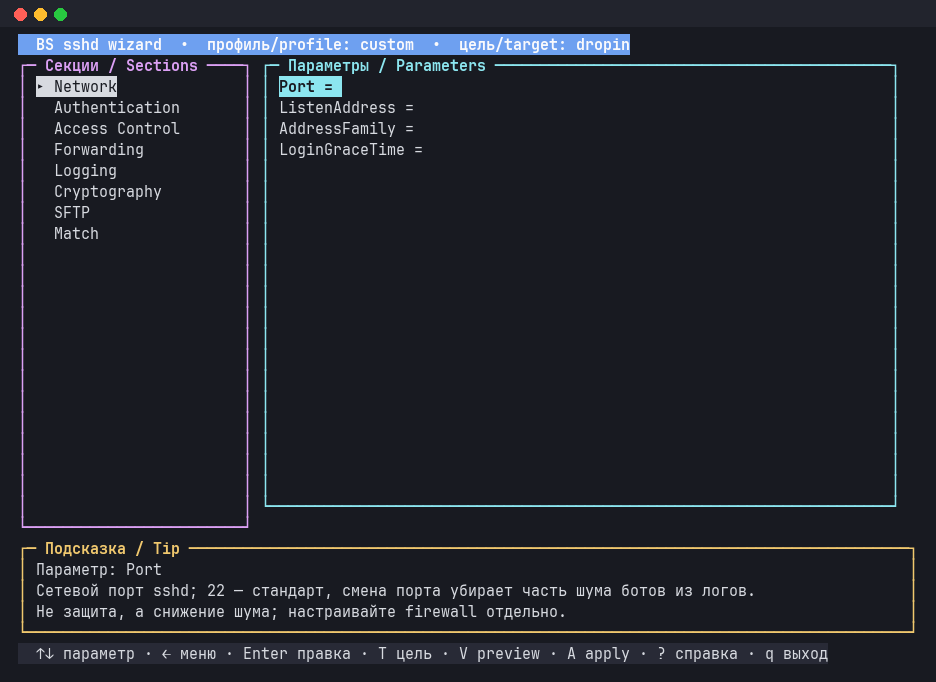

# 🐚 BS Framework

> 🇷🇺 Русская версия · 🇬🇧 [English version](README.en.md)

[](https://github.com/Igormm/bs/actions/workflows/ci.yml)


[](LICENSE)

**BS — модульный фреймворк и стандартная библиотека для shell-скриптов.**
Пишешь скрипт, подключаешь нужные модули через `load`, остальное берёт на
себя фреймворк.

<p align="center">
  
</p>

## ✨ Почему BS

- 📦 **Загрузчик модулей** с разрешением зависимостей: `load "lib/io/streams"`, и всё нужное подтянется само
- 📝 **Логирование** и 🛡️ **обработка ошибок** из коробки
- ⚙️ **Параметры скрипта одной декларацией**: валидация, `--help` и автодополнение сами
- 🖥️ **TUI на чистом bash**: окна, меню, модалки, мышь
- 🧰 **100+ модулей**: файлы, процессы, сеть, железо, сервисы, HTTP, LLM, Kubernetes
- 📦 **`bs build`**: скрипт и фреймворк в одном файле, который работает без установки
- 🐚 **Ядро на POSIX sh**, стандартная библиотека на Bash 4.2+
- 🎯 **Ноль внешних зависимостей** и единый стиль кода

## 🚀 Быстрый старт

```bash
git clone https://github.com/Igormm/bs.git && cd bs

./bs run examples/hello.sh     # первый скрипт
./bs repl                      # интерактивная консоль
./bs doctor                    # проверить, что всё на месте
```

Понравилось? Установите команду `bs` себе в `PATH`:

```bash
./install.sh --local           # в ~/.local, без sudo
```

## 👋 Примеры

### Hello, world

```bash
#!/usr/bin/env bs

load "lib/io/streams"

io::streams::print "hello from BS $(bs::version::get)"
```

```console
$ bs run examples/hello.sh
hello from BS 0.20.0
```

### 📝 Логи без лишнего кода

Логгер и проверки вроде `is::file` доступны сразу, без `load`:

```bash
#!/usr/bin/env bs

log::info "Начинаю резервную копию"
if is::file "/etc/hostname"; then
    log::success "Файл на месте, можно копировать"
else
    log::warn "Файла нет, пропускаю"
fi
```

```console
[2026-11-11 08:06:35] INFO  Начинаю резервную копию
[2026-11-11 08:06:35] SUCCESS Файл на месте, можно копировать
```

### ⚙️ Скрипт с параметрами

Описываете параметры один раз, а проверку, сообщения об ошибках и `--help`
BS делает сам. Значения читаются по смыслу: `args::param 1` (первое слово
команды) и `args::flag_get name` (значение `--name`).

```bash
#!/usr/bin/env bs

load "core/args"
load "lib/io/streams"

main() {
    args::level 1 hello goodbye
    args::flag name value world
    args::flag loud
    args::required 1
    args::require "$@"

    # args::param 1        — первое слово после имени скрипта (hello или goodbye)
    # args::flag_get name  — значение --name; без него — дефолт world
    local -r command="$(args::param 1)"
    local -r name="$(args::flag_get name)"
    local msg
    case "${command}" in
        hello)   msg="Hello, ${name}!" ;;
        goodbye) msg="Goodbye, ${name}!" ;;
    esac
    args::flag_is_set loud && msg="${msg^^}"
    io::streams::print "${msg}"
}

main "$@"
```


Полная версия с описаниями для `--help`: [examples/greet.sh](examples/greet.sh).

### 🎛️ Меню в терминале


`↑↓` выбор, `Enter` действие, `q` выход. Полный пример с циклом
обработки клавиш: [examples/menu.sh](examples/menu.sh).

```bash
load "lib/tui/tui"

main() {
    local -a items=("Run checks" "Show status" "Quit")
    local -i sel=0

    # полноэкранный режим
    tui::init
    # меню в точке (2, 2), выбран пункт sel
    tui::menu 2 2 items "${sel}" "Menu"
    tui::render
    # ждём клавишу: она окажется в $TUI_KEY
    tui::key_read
    # ...
}
```

<br clear="right">

## 🖼️ Что можно собрать на BS

Всё это лежит в [examples/](examples/) и запускается одной командой.

| | |
|---|---|
| ✅ **Список задач** `examples/todo.sh`<br>Окна, модалки, файл задач. |  |
| 🔐 **Мастер настройки sshd** `examples/sshd_wizard.sh --dry-run`<br>Профили, подсказка к каждому параметру, безопасное применение. |  |
| 🌐 **Сеть** `examples/netconn.sh`<br>Интерфейсы, адреса, трафик в реальном времени. |  |

Ещё примеры:

- 🛡️ `fail2ban_wizard.sh`, `ntp_wizard.sh`, `locale_wizard.sh`: мастера настройки системы
- 🔑 `openbao_wizard.sh`: установка OpenBao, [подробнее](documentation/ru/03-modules/system-openbao.md)
- 🛰️ `vpn.sh`: VPN-клиент на sing-box и Xray с TUI, [подробнее](documentation/ru/03-modules/network-vpn.md)
- 💓 `pulse.sh`, `sysdiag.sh`: быстрый осмотр машины
- 🌍 `http_example.sh`, `llm_example.sh`, `k8s_example.sh`: интеграции

## 🧰 Инструменты `bs`

| Команда | Что делает |
|---|---|
| `bs run script.sh` | запустить скрипт (или `#!/usr/bin/env bs` в шапке) |
| `bs repl` | консоль с загруженным ядром, `:list`, `:doc`, `:info` |
| `bs calc '2 3 4 * +'` | RPN-калькулятор |
| `bs list` | список модулей |
| `bs build script.sh` | один самодостаточный файл, работает без установки BS |
| `bs doctor` | проверка целостности |
| `bs update` | обновить установленные копии |
| `bs where` | найти все установки BS на машине |

## 📦 Установка

```bash
./install.sh --local      # ~/.local/bin/bs, без sudo
sudo ./install.sh         # /usr/local/bin/bs, для всех
```

Установщик копирует фреймворк, так что клон потом можно удалить. Виды
установки, обновление и удаление описаны в
[documentation/ru/install.md](documentation/ru/install.md).

**Что нужно:** Linux и Bash 4.2+ (CI проверяет 4.4–5.x на ubuntu, debian и
almalinux 8–9). Запускать `bs` можно из любой оболочки: он сам найдёт bash.

## 🗂️ Устройство

```
bs              CLI и интерпретатор
bootstrap/      загрузчик модулей
core/           ядро: args, logger, errorhandler, utils, lang …
lib/            стандартная библиотека: io, tui, system, network, integration …
examples/       примеры
tests/          тесты
documentation/  документация на русском и английском
```

## 🧪 Тесты

```bash
bash tests/runalltests.sh          # весь набор
bash tests/validateshellcheck.sh   # ShellCheck
```

## 📚 Документация

- 🏁 [Начало работы](documentation/ru/01-getting-started/README.md)
- ✍️ [Первый скрипт: пошаговый урок](documentation/ru/05-tutorials/first-script.md)
- 🏗️ [Архитектура](documentation/ru/02-core-concepts/architecture.md)
- 🧩 [Обзор модулей](documentation/ru/03-modules/lib-modules-overview.md)
- 📖 [Справочник API ядра](documentation/ru/04-api-reference/core-api.md)
- 🎨 [Стиль кода](documentation/ru/code-style-guide.md)
- 🇬🇧 [English documentation](documentation/en/README.md)

## 💡 Принципы

- **Bash есть везде:** ничего не нужно ставить.
- **Это bash, а не новый язык:** вся экосистема bash открыта, `bash -x` работает.
- **Без магии:** каждая строка читается как обычный bash.
- **Для эксплуатации:** cron, CI, Docker, один файл через `bs build`.
- **Честные границы:** тяжёлую работу с данными отдаём jq или Go через JSON.

## 📄 Лицензия

MIT, см. [LICENSE](LICENSE).
