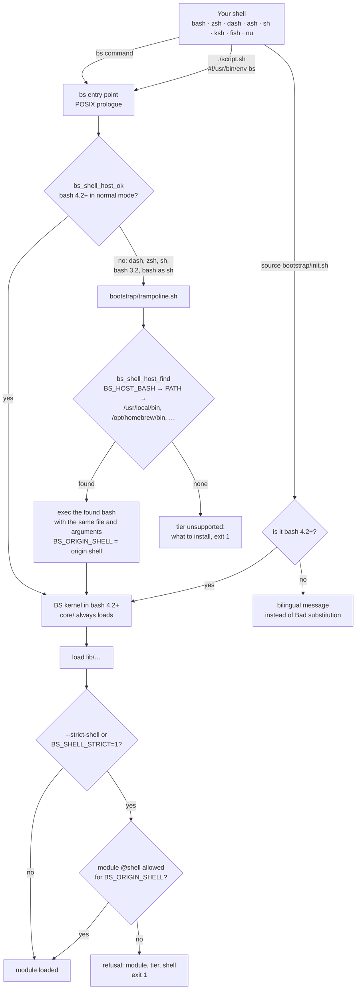
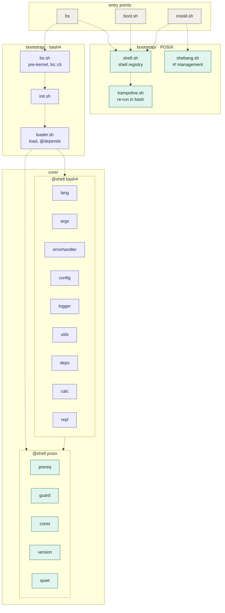
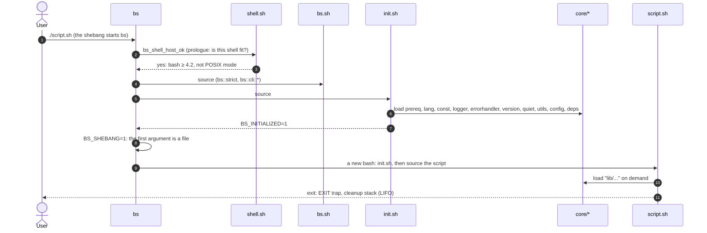
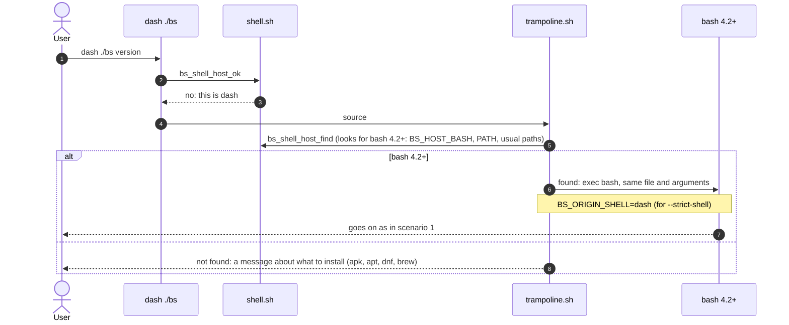
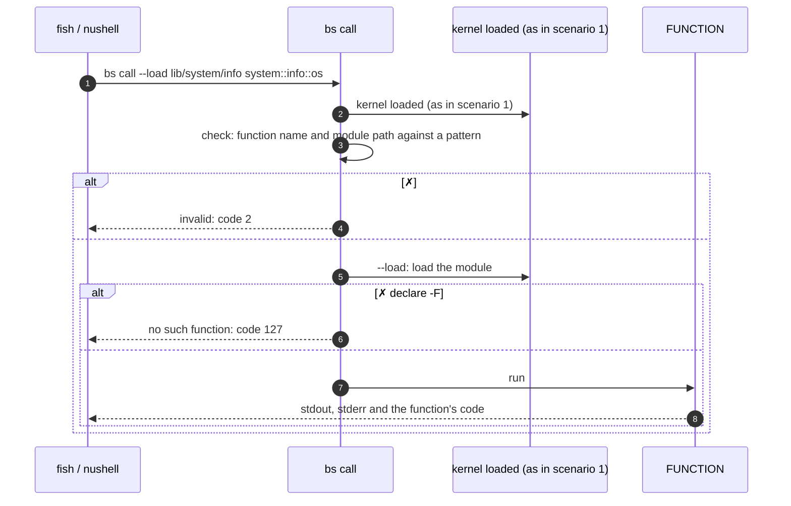
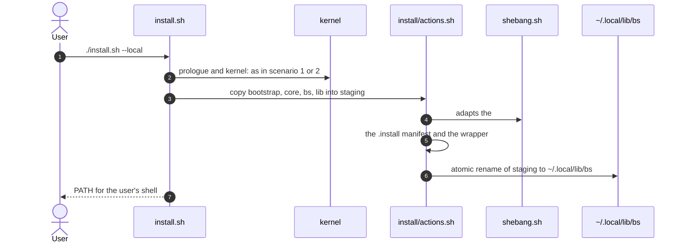
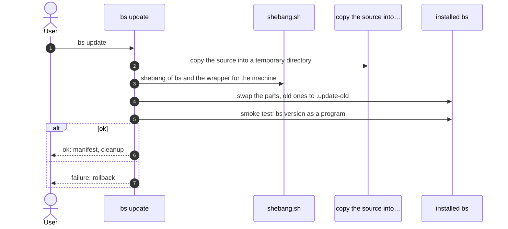

[↑ Documentation index](../README.md)

# Getting Started

## What is BS

**BS** is a modular framework and standard library written in Bash. It provides
a module loader, logging, error handling, declarative script arguments, an
I/O streams abstraction, and a set of system modules — all in one consistent
code style and with zero external dependencies.

The `bs` command and BS scripts can be started from any shell: bash, zsh,
dash, ash/busybox, sh, ksh, fish, nushell. Which bash runs the code and what
your shell is allowed to load is decided by the tier mechanism; see
[Running from any shell](#running-from-any-shell).

## Requirements

- **bash 4.2+** somewhere in `PATH`: the kernel (the `bash4` tier) runs on it.
  Versions 4.2 and 4.3 are accepted by the code, but CI checks from **4.4**
  (nearly every platform ships 4.4 or newer).
- You can start `bs` and `install.sh` **from any shell** (dash, ash, zsh, ksh,
  fish, nushell): the prologue finds bash and re-runs itself in it. `@shell
  posix` modules are sourced directly from bash, zsh, dash, ash, ksh, mksh (see
  "How the kernel works"); fish and nushell call kernel functions through
  `bs call`. More in [Running from any shell](#running-from-any-shell).
- Linux (primary platform; macOS is partially supported: the system bash there
  is 3.2, install bash 4.2+ from Homebrew)
- Termux (Android): [`bs shebang`](#a-shebang-for-this-machine) fits the first
  line of scripts to the machine.

Nothing else is required: BS relies on shell built-ins and standard system
tools only.

## Installation

BS runs straight from the repository — installation is optional and only
puts the `bs` command into your `PATH`.

### Run from the repository

```bash
git clone <repo-url> bs
cd bs
./bs doctor
```

### Local install (`~/.local`, no sudo)

```bash
./install.sh --local
```

Copies the framework to `~/.local/lib/bs`, creates a wrapper at
`~/.local/bin/bs`, and adds `~/.local/bin` to `PATH` in the rc file of your
shell (plus existing `~/.bashrc` / `~/.zshrc`; `--shell NAME` picks the shell
explicitly), idempotently. PATH helpers:

```bash
./install.sh --local --path          # print the export snippet
./install.sh --local --update-path   # add to the rc file of your shell
```

### System install (`/usr/local`, requires root)

```bash
sudo ./install.sh
```

Files go to `/usr/local/lib/bs`, the wrapper to `/usr/local/bin/bs`.

Install locations can be overridden with the `PREFIX`, `BIN_DIR`, and
`LIB_DIR` environment variables.

### Uninstall

```bash
sudo ./install.sh uninstall      # system
./install.sh --local uninstall   # local
```

> **Note on the source directory.**  
> The installer **copies** BS files to the target directory
> (`~/.local/lib/bs` for `--local`, `/usr/local/lib/bs` for system
> install; paths can be overridden via `PREFIX`/`LIB_DIR`/`BIN_DIR`)
> and creates a `bs` wrapper in the matching `bin/`. After a successful
> install, the source repository can be removed — the framework will
> run from the target directory.

## Verify the installation

```bash
./bs doctor    # framework integrity check
./bs list      # list modules
./bs version   # framework version
./bs version --full   # + where this copy is from
```

- `bs doctor` checks that `bootstrap/init.sh`, the core modules, and the
  `core/` and `lib/` directories are present under `BS_ROOT`, and exits
  non-zero if anything is missing.
- `bs doctor` also shows the `shell (host)` row (which bash runs BS), the
  `shell (yours)` row (your shell and its tier) and the number of modules
  annotated `@shell posix` / `@shell bash4`.
- `bs where` shows where this copy of BS lives, whether the `bs` command is
  in `PATH`, and a Shell section: host, your shell (login and parent
  process), tier.
- `bs list` prints the modules located directly in `core/` and `lib/`
  (for example `core/args.sh`, `lib/automation.sh`). Nested modules such as
  `lib/io/streams.sh` live in subdirectories and are loaded by path.

## Your first script

Runnable copy: [examples/hello.sh](../../../examples/hello.sh).

```bash
#!/usr/bin/env bs
# shellcheck shell=bash

load "lib/io/streams"

io::streams::print "hello from BS $(bs::version::get)"
```

- `#!/usr/bin/env bs` — runs the script through the `bs` interpreter; the
  framework core is loaded before your code, so no bootstrap boilerplate is
  needed.
- `# shellcheck shell=bash` — required on line 2 when the shebang is `bs`.
- Strict mode is already enabled by the interpreter (`set -euo pipefail`
  before your script is sourced) — no strict line needed here. Only plain
  `#!/usr/bin/env bash` entry points set it themselves, via `utils::strict`
  (post-kernel) or the pre-kernel `bs::strict` from `bootstrap/bs.sh`.
- `load "lib/io/streams"` — path relative to `BS_ROOT`, no `.sh`. Never
  `source` framework modules directly in a new script.
- `io::streams::print` — safe output: a `printf '%s\n'` wrapper that does
  not break on values like `-n` or `-e`. The version comes from the core
  function `bs::version::get`.

## Running scripts

```bash
./bs run examples/hello.sh
./examples/hello.sh          # when bs is in PATH
```

Landing examples:

```bash
./bs run examples/hello.sh     # short script
./bs run examples/todo.sh      # TUI todo list (lib/tui)
./bs run examples/pulse.sh     # host capability pulse
```

CLI with `core/args` (auto-help, validation) is in the
[first-script tutorial](../05-tutorials/first-script.md).

## Running from any shell

The kernel and `lib/` are written in bash 4.2+ (arrays, `[[ ]]`, `local -r`),
but BS can be started from any shell. The code is always run by a bash found
on the machine; the shell you come from only affects the `PATH` setup, the
hints and, in strict mode, which modules are allowed.

### Three shells

| Role | What it is | Decided by |
|---|---|---|
| **host** | the interpreter that runs the BS code | always bash 4.2+: the one that started `bs`, or the one the trampoline finds (`BS_HOST_BASH` wins over the search) |
| **your shell** | where you type commands; its rc file gets `PATH` | `BS_USER_SHELL`, else the parent process, else the login shell |
| **origin shell** | the shell that first read the `bs` file | exported by the trampoline as `BS_ORIGIN_SHELL`; without the trampoline it is `bash` |

### Start-up diagram



In bash 4.2+ the prologue is one test and re-runs nothing. Coming back to the
trampoline after the `exec` counts as a failure and stops, so start-up cannot
loop. These paths step by step, plus `bs call`, the POSIX tier without bash,
install and update, are in
[How the kernel works: UML diagrams](#how-the-kernel-works-uml-diagrams).

### The tier of your shell

The answer to "how does BS work for me":

| tier | meaning |
|---|---|
| `native` | your shell is bash 4.2+: both the `bs` commands and sourcing the library work |
| `hosted` | another shell: BS works as the `bs` command, run by a bash 4.2+ found on the machine; `PATH` and the rc file fit your shell |
| `unsupported` | no bash 4.2+ on the machine: BS does not start and says what to install |

Where to see it:

```bash
bs where                  # the Shell section: host, your shell, tier
bs doctor                 # the shell (host) and shell (yours) rows
bs init-shell --list      # every known shell: tier, rc file, reload command
bs init-shell             # what to add to the rc file of YOUR shell
```

### Module tier: the `@shell` annotation

Every file can declare which shell language it is written in with a
`# @shell` line in its header, followed by a bilingual reason after a dash:

```bash
# @shell bash4 — нужны массивы и [[ ]] / needs arrays and [[ ]]
```

| module tier | allowed from |
|---|---|
| `posix` | any shell |
| `bash4` (default when there is no annotation) | bash 4.2+ |
| a shell name (`zsh`, `fish`, `nu`, …) | that shell only |
| a comma list (`zsh,bash4`) | any of them |

Synonyms: `sh`, `shell`, `posix` = `posix`; `bash`, `bash4` = `bash4`;
`fs`, `fish` = `fish`; `nu`, `nushell` = `nu`.

This axis is independent of `@tier core | gnu-linux`, which describes the
userland (tools) a module needs; `@shell` describes the language of the file.

### Strict shell selection

By default the trampoline gives any shell any module: bash runs the code
anyway. To guarantee that a script uses only modules written for the shell it
was started from, turn on strict mode:

```bash
dash ./bs --strict-shell run script.sh   # the flag goes BEFORE the command
BS_SHELL_STRICT=1 dash ./bs run script.sh
```

A `lib/` module then loads only if its `@shell` is allowed for the origin
shell. The refusal names the module, its tier and the shell, and exits 1:

```text
BS: module 'lib/io/streams' (@shell bash4) cannot run from shell 'dash' (--strict-shell)
```

Strict-mode rules:

- `core/` is always allowed: nothing starts without the kernel.
- The origin shell is the one that first read the `bs` file. A bash that
  reached the trampoline (bash 3.2 or bash in POSIX mode) counts as `sh`.
- A `#!/usr/bin/env bs` script run as `./script.sh` always starts through
  the `#!/usr/bin/env bash` line of `bs` itself, so its origin shell is
  `bash` whichever shell you call it from. A flag cannot be passed through a
  shebang, so use `BS_SHELL_STRICT=1`; to check against a specific shell,
  run `<shell> ./bs --strict-shell run script.sh`.

### Calling from fish and nushell: `bs call`

fish and nushell have a different syntax, so they cannot source the kernel. A
kernel or module function can be called as a command instead: it runs in bash,
and its stdout, stderr and exit code are yours.

```bash
bs call utils::human_size 1536000                  # 1.5 MiB
bs call --load lib/system/info system::info::os     # loading a module first
```

From fish: `set size (bs call utils::human_size 1536000)`. Only an existing
function with a valid name runs (otherwise exit 2 or 127); a module path may
only be `core/...` or `lib/...`.

### Variables that set the shell explicitly

| Variable | What it sets |
|---|---|
| `BS_HOST_BASH=/path/to/bash` | which bash the trampoline takes when BS is not started from bash 4.2+; an invalid value is an error, with no silent fallback to the search |
| `BS_USER_SHELL=zsh` | your shell: it decides the rc file, the `PATH` line and the tier |
| `BS_SHELL_STRICT=1` | strict mode, same as `--strict-shell` |

### A shebang for this machine

A shebang needs an absolute path. On most Linux systems that is
`/usr/bin/env`, but Termux has no `/usr`. The `bs shebang` command checks and
rewrites the first line of scripts:

```bash
bs shebang info                 # where env is here, which modes work
bs shebang check examples/      # does each file's shebang work here
bs shebang set --mode auto examples/   # rewrite where needed
```

Modes: `portable` (`#!/usr/bin/env bs`, for sharing), `env` (this machine's
env), `abs` (full path of `bs`), `auto` (default: `portable` if
`/usr/bin/env` exists, otherwise `env`).

Details: [Shell portability](../08-development/shell-portability.md) and
[Architecture](../02-core-concepts/architecture.md).

## How the kernel works: UML diagrams

The diagrams below use [Mermaid](https://mermaid.js.org/) (GitHub draws them itself). Colour carries meaning: **teal** — the `@shell posix` tier (runs in any shell), **purple** — the `@shell bash4` tier (needs bash 4.2+), grey — entry points. First the overall picture, then six scenarios.

### Components



Arrows are dependencies (who sources whom). `init.sh` loads the `core/` files of the package top to bottom.

### Scenarios

#### 1. `bs script.sh` or `#!/usr/bin/env bs` from bash 4.2+


<details>
<summary>Diagram source (Mermaid)</summary>



</details>

#### 2. Start from dash, ash or another shell: re-run in bash


<details>
<summary>Diagram source (Mermaid)</summary>



</details>

#### 3. Calling a kernel function from fish or nushell: `bs call`


<details>
<summary>Diagram source (Mermaid)</summary>



</details>

#### 4. The POSIX tier directly, without bash


<details>
<summary>Diagram source (Mermaid)</summary>

```mermaid
sequenceDiagram
  autonumber
  participant D as a dash script sources the layer
  participant sh as shell.sh
  participant pre as prereq.sh
  participant q as quiet.sh
  D->>sh: . bootstrap/shell.sh
  D->>pre: . core/prereq.sh
  D->>q: . core/quiet.sh
  D->>q: utils_has ls
  q-->>D: code 0 or 1; bash was not started
```

</details>

#### 5. Install: `./install.sh --local`


<details>
<summary>Diagram source (Mermaid)</summary>



</details>

#### 6. Update: `bs update`


<details>
<summary>Diagram source (Mermaid)</summary>



</details>


## Where to go next

- [Architecture](../02-core-concepts/architecture.md) — boot stages,
  `BS_ROOT`, the module loader
- [core/args module](../03-modules/args.md) — parameter trees, flags,
  bash completion
- [lib/io/streams module](../03-modules/io-streams.md) — safe printing,
  redirection, pipes
- [Tutorial: your first script](../05-tutorials/first-script.md) — a
  step-by-step walkthrough

See also the [repository README](../../../README.md) and the runnable
examples in [examples/](../../../examples/).
