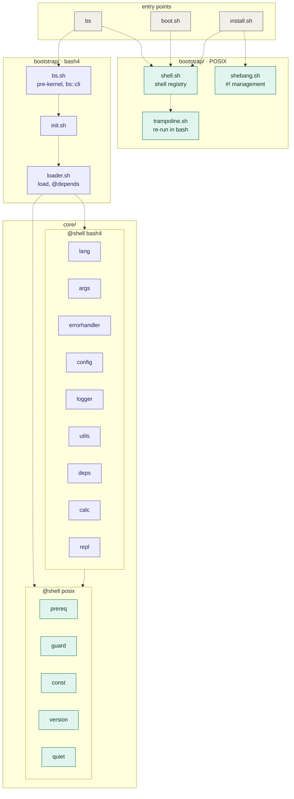
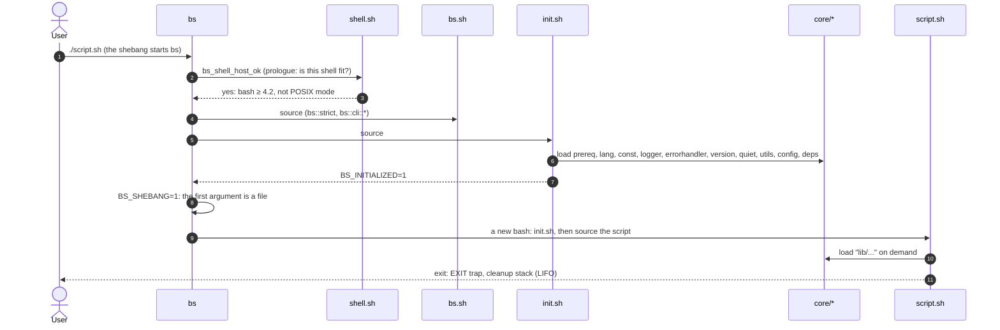
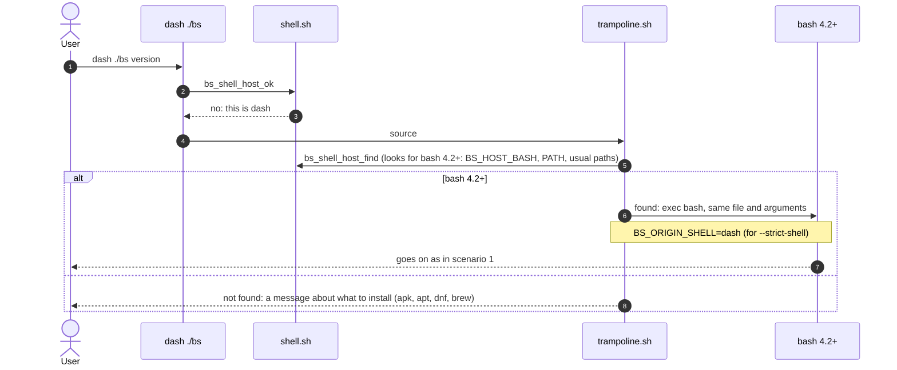
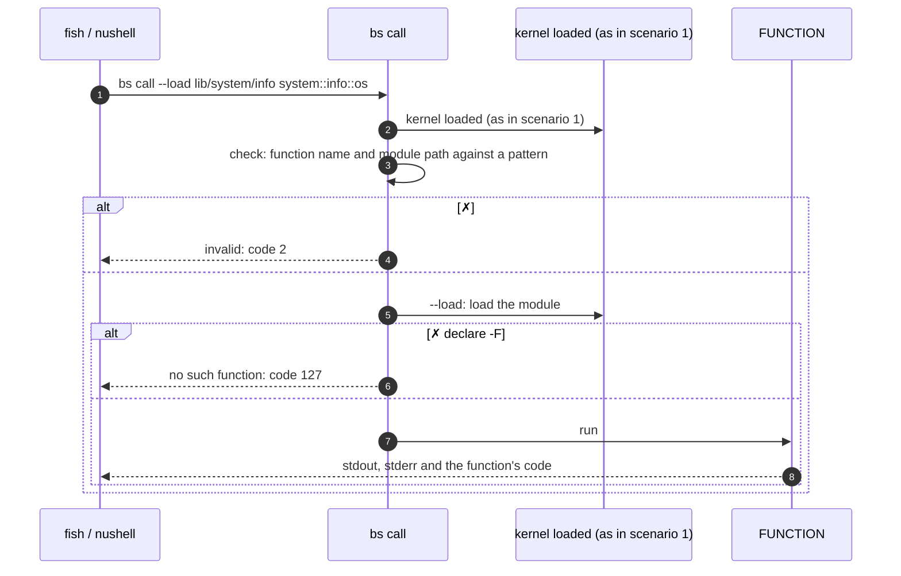
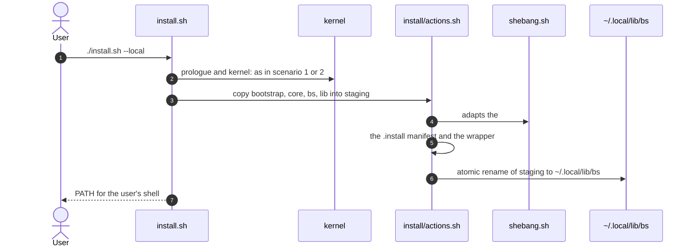
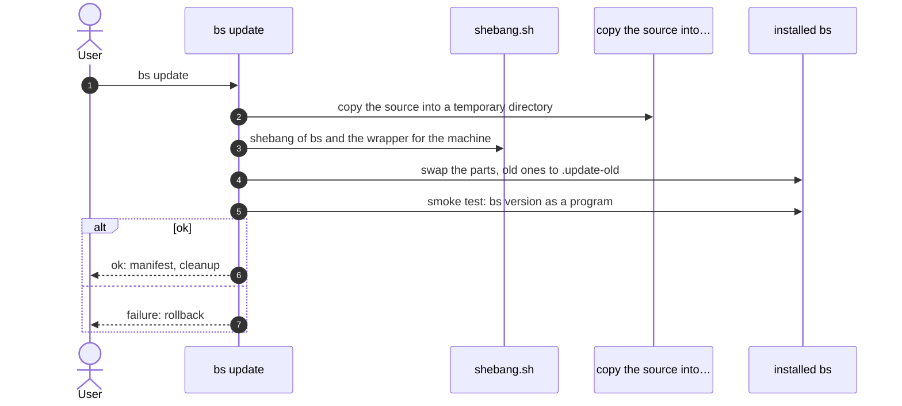

[↑ Documentation index](../README.md)

# Getting Started

## What is BS

**BS** is a modular framework and standard library written in **Bash 4.2+**. It provides
a module loader, logging, error handling, declarative script arguments, an
I/O streams abstraction, and a set of system modules — all in one consistent
code style and with zero external dependencies.

## Requirements

- **bash 4.2+ is a hard requirement.** All of the `lib/` library (87 modules) and
  1 of the 19 `core/` files are written in bash, so BS does not run without it.
  Versions 4.2 and 4.3 are accepted by the code, but CI checks from **4.4**
  (nearly every platform ships 4.4 or newer).
- The exception is the 18 kernel files labelled `@shell posix`: they do not depend
  on bash and can be sourced from dash, ash, ksh, mksh, zsh and bash (see "How the
  kernel works"). That is a small set of helpers (constants, the version,
  `bs_utils_has`, `bs_log_info`, `calc`, …), not the whole of BS.
- You can start `bs` and `install.sh` **from any shell** (dash, ash, zsh, ksh,
  fish, nushell): the prologue finds bash and re-runs itself in it, so for `bs`
  bash must be on the system but need not be your shell.
- **`install.sh` does not need bash at all**: with no bash 4.2+ on the machine it
  runs in dash, ash, ksh, mksh or zsh and installs BS (see
  [install](../install.md#installing-without-bash)); only the installed `bs`
  command and `lib/` then need bash.
- Linux (primary platform; macOS is partially supported: the system bash there
  is 3.2, install bash 4.2+ from Homebrew)

Nothing else is required: BS relies on bash built-ins and standard system
tools only.

**Heading for shell independence.** The goal is a kernel (`bootstrap/`, `core/`,
`install/`, `boot.sh`, `bs`, `install.sh`) in one namespace `bs_*` that does not
depend on the shell (dash, ash, ksh, mksh, zsh, bash). Already done: 18 of the 19
`core/` files (including the array and map layer `core/data.sh`) and the shell
layer in `bootstrap/`; the rest moves by plan (see
[shell-portability](../08-development/shell-portability.md#heading-for-shell-independence)).
All of the `lib/` library is for now written for bash 4.2+ (zsh parses 85 of the
87 files, but `lib/` was not run in zsh).

## Installation

BS runs straight from the repository — installation is optional and only
puts the `bs` command into your `PATH`.

### Run from the repository

```bash
git clone <repo-url> bs
cd bs
./bs doctor
```

### Local install (`~/.local`, no sudo)

```bash
./install.sh --local
```

Copies the framework to `~/.local/lib/bs`, creates a wrapper at
`~/.local/bin/bs`, and adds `~/.local/bin` to `PATH` in `~/.bashrc` /
`~/.zshrc` (idempotently). PATH helpers:

```bash
./install.sh --local --path          # print the export snippet
./install.sh --local --update-path   # add to ~/.bashrc / ~/.zshrc
```

### System install (`/usr/local`, requires root)

```bash
sudo ./install.sh
```

Files go to `/usr/local/lib/bs`, the wrapper to `/usr/local/bin/bs`.

Install locations can be overridden with the `PREFIX`, `BIN_DIR`, and
`LIB_DIR` environment variables.

### Uninstall

```bash
sudo ./install.sh uninstall      # system
./install.sh --local uninstall   # local
```

> **Note on the source directory.**  
> The installer **copies** BS files to the target directory
> (`~/.local/lib/bs` for `--local`, `/usr/local/lib/bs` for system
> install; paths can be overridden via `PREFIX`/`LIB_DIR`/`BIN_DIR`)
> and creates a `bs` wrapper in the matching `bin/`. After a successful
> install, the source repository can be removed — the framework will
> run from the target directory.

## Verify the installation

```bash
./bs doctor    # framework integrity check
./bs list      # list modules
./bs version   # framework version
./bs version --full   # + where this copy is from
```

- `bs doctor` checks that `bootstrap/init.sh`, the core modules, and the
  `core/` and `lib/` directories are present under `BS_ROOT`, and exits
  non-zero if anything is missing.
- `bs list` prints the modules located directly in `core/` and `lib/`
  (for example `core/args.sh`, `lib/automation.sh`). Nested modules such as
  `lib/io/streams.sh` live in subdirectories and are loaded by path.

## Your first script

Runnable copy: [examples/hello.sh](../../../examples/hello.sh).

```bash
#!/usr/bin/env bs
# shellcheck shell=bash

load "lib/io/streams"

io::streams::print "hello from BS $(bs::version::get)"
```

- `#!/usr/bin/env bs` — runs the script through the `bs` interpreter; the
  framework core is loaded before your code, so no bootstrap boilerplate is
  needed.
- `# shellcheck shell=bash` — required on line 2 when the shebang is `bs`.
- Strict mode is already enabled by the interpreter (`set -euo pipefail`
  before your script is sourced) — no strict line needed here. Only plain
  `#!/usr/bin/env bash` entry points set it themselves, via `utils::strict`
  (post-kernel) or the pre-kernel `bs::strict` from `bootstrap/bs.sh`.
- `load "lib/io/streams"` — path relative to `BS_ROOT`, no `.sh`. Never
  `source` framework modules directly in a new script.
- `io::streams::print` — safe output: a `printf '%s\n'` wrapper that does
  not break on values like `-n` or `-e`. The version comes from the core
  function `bs::version::get`.

## Running scripts

```bash
./bs run examples/hello.sh
./examples/hello.sh          # when bs is in PATH
```

Landing examples:

```bash
./bs run examples/hello.sh     # short script
./bs run examples/todo.sh      # TUI todo list (lib/tui)
./bs run examples/pulse.sh     # host capability pulse
```

CLI with `core/args` (auto-help, validation) is in the
[first-script tutorial](../05-tutorials/first-script.md).

## How the kernel works: UML diagrams

The diagrams below use [Mermaid](https://mermaid.js.org/) (GitHub draws them itself). Colour carries meaning: **teal** — the `@shell posix` tier (runs in any shell), **purple** — the `@shell bash4` tier (needs bash 4.2+), grey — entry points. First the overall picture, then six scenarios.

### Components



Arrows are dependencies (who sources whom). `init.sh` loads the `core/` files of the package top to bottom.

### Scenarios

#### 1. `bs script.sh` or `#!/usr/bin/env bs` from bash 4.2+



<details>
<summary>Diagram source (Mermaid)</summary>



</details>

#### 2. Start from dash, ash or another shell: re-run in bash


<details>
<summary>Diagram source (Mermaid)</summary>



</details>

#### 3. Calling a kernel function from fish or nushell: `bs call`


<details>
<summary>Diagram source (Mermaid)</summary>



</details>

#### 4. The POSIX tier directly, without bash


<details>
<summary>Diagram source (Mermaid)</summary>

```mermaid
sequenceDiagram
  autonumber
  participant D as a dash script sources the layer
  participant sh as shell.sh
  participant pre as prereq.sh
  participant q as quiet.sh
  D->>sh: . bootstrap/shell.sh
  D->>pre: . core/prereq.sh
  D->>q: . core/quiet.sh
  D->>q: bs_utils_has ls
  q-->>D: code 0 or 1; bash was not started
```

</details>

#### 5. Install: `./install.sh --local`


<details>
<summary>Diagram source (Mermaid)</summary>



</details>

#### 6. Update: `bs update`


<details>
<summary>Diagram source (Mermaid)</summary>



</details>


## Where to go next

- [Architecture](../02-core-concepts/architecture.md) — boot stages,
  `BS_ROOT`, the module loader
- [core/args module](../03-modules/args.md) — parameter trees, flags,
  bash completion
- [lib/io/streams module](../03-modules/io-streams.md) — safe printing,
  redirection, pipes
- [Tutorial: your first script](../05-tutorials/first-script.md) — a
  step-by-step walkthrough

See also the [repository README](../../../README.md) and the runnable
examples in [examples/](../../../examples/).
