[↑ Developer guide](README.md)

# Shell portability

**BS requires bash 4.2+.** All of `lib/` (87 modules, none of them POSIX) and 3 of the 19 kernel
files are written in bash; only 16 small `@shell posix` kernel files and the prologue of the entry
points do not depend on it. "Usable from most shells" means: `bs` can be started from any shell
(it re-runs in bash) and `install.sh` runs even with no bash at all (dash, ash, ksh, mksh, zsh; see
"The installer and `init.sh` without bash" below), kernel functions are called from any shell with
`bs call`, and the POSIX files are sourced directly. This page is the
design behind branch `fix/kernel-security-p0`; the working rules for authors
are in the skill `.agents/skills/bs-shell-portability/SKILL.md`.

## Three shells, not one

| Role | Meaning | Who decides |
|---|---|---|
| **host** | the interpreter that executes BS code | always bash ≥ 4.2 (found by the trampoline) |
| **user shell** | where the person types commands; whose rc file gets PATH | `--shell`, `BS_USER_SHELL`, parent process, login shell |
| **script shell** | the shebang of a user script (`#!/usr/bin/env bs`) | the script |

The kernel and `lib/` need arrays, namerefs, `[[ ]]`, `local -r`. They stay
bash. What is made shell-independent is everything *around* them: entry
points, installer, PATH setup, checks, uninstall, `bs where`.

## Access modes

- **exec** — `bs ...` from any shell. The entry point starts with a POSIX
  prologue; if the interpreter is not bash ≥ 4 (or bash in POSIX mode) it
  sources `bootstrap/trampoline.sh`, which finds a capable bash and
  `exec`s the same file with the same arguments.
- **source** — `source bootstrap/init.sh`. Only bash 4.2+. Elsewhere it answers
  with a bilingual message instead of `Bad substitution`.
- **call** — `bs call [--load MODULE] FUNCTION [ARGS]`: the bridge for shells
  with another syntax (fish, nushell, dash, ash, ksh). A kernel or module
  function runs in the bash that `bs` starts; its stdout and stderr are yours,
  and its exit code becomes the exit code of `bs call`. Only an existing
  function with a valid name runs (`rm`, `a;b`, `$(id)` are refused), a module
  path is only `core/...` or `lib/...` without `..`. Example: `bs call
  utils::human_size 1536000`; from fish: `set size (bs call utils::human_size
  1536000)`.
- **trampoline** — the mechanism of the first mode. `BS_HOST_BASH=/path`
  overrides the search (an invalid value is an error, never a silent fallback).
  With no bash 4.2+ it prints install hints (apk/apt/dnf/brew) and exits 1.

## Tiers

Two independent axes:

- `@tier core | gnu-linux` — what *userland* the module needs (unchanged).
- `@shell posix | bash4` — what *language* the file is written in. Absent means
  `bash4`. The line carries a bilingual reason after the dash:
  `# @shell bash4 — arrays and [[ ]] are used`.

Per user, the effective result is `platform::get shell_tier`:

| tier | meaning |
|---|---|
| `native` | the user's shell is bash 4.2+; BS can be sourced |
| `hosted` | another shell; BS works as the `bs` command run by a found bash |
| `unsupported` | no bash 4.2+ on the machine |

A dependency that cannot be removed is not hidden: the module is `bash4` and
says why in the annotation.

## The shell registry — `bootstrap/shell.sh`

POSIX code. Functions are named `bs_shell_*` (dash rejects `::` in names);
`bs::shell::*` aliases are created by `eval` in bash/zsh only. It knows the
families `bash zsh dash ash sh ksh mksh oksh osh fish nu` and answers:
`family`, `user`, `rc_file`, `path_line`, `reload_hint`, `fresh_flags`,
`all_rc_files`, `host_find`, `tier`, `tier_desc`.

| shell | rc file | PATH line |
|---|---|---|
| bash | `~/.bashrc` | `export PATH="$HOME/.local/bin:$PATH"` |
| zsh | `${ZDOTDIR:-~}/.zshrc` | same |
| dash, ash, sh, ksh, mksh, oksh | `~/.profile` | same |
| osh | `~/.config/oils/oshrc` | same |
| fish | `~/.config/fish/conf.d/bs.fish` | `contains -- … $PATH; or set -gx PATH …` |
| nu | `~/.config/nushell/env.nu` | `$env.PATH = ($env.PATH \| prepend …)` |

nushell: if `env.nu` does not exist the installer does not invent it; it
prints the exact line to add.

## Strict mode — `bs --strict-shell`

By default the trampoline lets any shell use any module (the code always runs
in bash). `--strict-shell` (or `BS_SHELL_STRICT=1`, needed for the shebang
mode) makes the `@shell` tier binding: a `lib/` module loads only if its tier
fits the shell BS was **started from** (`BS_ORIGIN_SHELL`, exported by the
trampoline; a bash that reached the trampoline counts as `sh`).

| tier of the module | allowed from |
|---|---|
| `posix` | any shell |
| `bash4` (default) | bash 4.2+ |
| another word (`zsh`, `fish`, `nu`, …) | the shell of that name |
| a list `zsh,bash4` | any of them |

Synonyms (tier words and shell names): `sh`, `shell`, `posix` = `posix`; `bash`, `bash4` = `bash4`; `fs`, `fish` = `fish`; `nu`, `nushell` = `nu`. An unknown word is kept as is.

`core/` (the kernel) is always allowed; otherwise nothing could start. A
refusal names the module, its tier and the origin shell, and exits 1:

```bash
dash ./bs --strict-shell run script.sh   # module lib/io/streams (@shell bash4) cannot run from 'dash'
```

**Parameter: name the shell.** `--strict-shell=SHELL` (or `--strict-shell SHELL` when the word is a known shell name) checks the tier against the **named** shell, wherever `bs` is started: it answers "will this work in dash". The name is one of `bash zsh ash dash sh ksh mksh oksh osh fish nu`; an unknown name is an error. Without a name the behaviour is as before: the check is against the shell bs was started from.

```bash
bs --strict-shell=dash run script.sh   # refuses if the script needs an @shell bash4 module
bs --strict-shell=bash run script.sh   # bash 4.2+ allows everything
./install.sh --local --strict-shell=zsh   # install for zsh: PATH and rc for zsh; refused if the machine has no bash 4.2+
```

The installer understands the same option as the shell BS is installed **for** (the same as `--shell SHELL`, but a tier `unsupported` is refused).

## Where shell-specific checks may live

Only in the abstraction layer: `bootstrap/bs.sh`, `bootstrap/shell.sh`, `bootstrap/trampoline.sh`. Anywhere else a direct use of `BASH_SOURCE`, `BASH_VERSION`, `FUNCNAME`, `ZSH_*`, `$SHELL`, `$0`-as-path must either call the layer (`bs::is_main`, `bs::script_dir`, `bs::func_name`, `bs::stack_*`, `bs_shell_host_ok`) or carry a `shell-gate` tag with the reason. `.agents/skills/bs-shell-abstraction/scripts/find_leaks.sh` checks this; the entry points share one prologue and read the bootstrap directory from `BS_ENTRY_DIR` / `BS_BOOTSTRAP_DIR`.

Beyond detection, the layer also gives: `bs::shell::host` (the running bash — start child shells with `"$(bs::shell::host)" -c`, never a bare `bash`), registry questions instead of family comparisons (`bs_shell_can_source`, `bs_shell_rc_create_ok`, `bs_shell_default_login_path`), and `args::completion PROG [bash|zsh|fish|nu]` (zsh is tested in a real zsh; fish and nushell only as text).

## Shell priorities

Priority comes from two things: **where the shell is found** (an estimate from
distributions and platforms, not a measurement) and **what was really verified
on this machine** (Fedora 43; `./bs version`, a script with `#!/usr/bin/env bs`,
`install.sh --help`, `bs init-shell`, `probe_shells.sh`). Fill the table only
with results of real runs.

| # | Shell | Where it is found | Version here | Runs `bs` and a script | Native kernel (`bash4`) | What to do |
|---|---|---|---|---|---|---|
| 1 | bash | nearly every Linux, Termux, WSL; macOS has the old 3.2 | 5.3.0 | yes | yes | the kernel host; the reference |
| 1 | zsh | macOS default, many Linux developers | 5.9 | yes | parses, behaves differently (arrays from 1, no `FUNCNAME`, `BASH_REMATCH`) | compatibility layer, completions |
| 2 | dash | `/bin/sh` on Debian/Ubuntu, install scripts | 0.5.12 | yes (trampoline) | no | POSIX kernel (`core/`) |
| 2 | busybox ash | Alpine, containers, routers, Termux | 1.37.0 | yes (trampoline) | no; friendlier than dash (`[[ ]]`, `pipefail`, `::`) | POSIX kernel, check in Termux |
| 3 | fish | popular interactive shell | 4.2.0 | yes, only as the `bs` command and a script with the shebang | not applicable (other syntax) | bridge (`bs call`), completion text |
| 3 | ksh93 | Unix, BSD, enterprise systems | 93u+m 1.0.10 | yes | parses; no `local`, `local -r`, `::` | POSIX kernel; no bash4 kernel promised |
| 3 | mksh | **the Android system shell**, OpenBSD (a fork) | R59 | yes | does not parse fully | POSIX kernel |
| 4 | nushell | growing, developers | not installed | not verified | not applicable | bridge, check after installing |
| 4 | oksh, osh | rare | not installed | not verified | — | do not develop |

"Yes" in the run column means: `./bs version` through this shell and a script
with `#!/usr/bin/env bs` worked; `install.sh --help` printed the help. "No" for
the bash4 kernel is not an error: the kernel runs in the bash the trampoline
found, and the other shells get POSIX modules and the bridge.

Development order: **1 → 2 → 3 → 4**. At levels 2–3 the main contribution is
growing the POSIX kernel (see "POSIX modules of the kernel") and the bridge for
shells with another syntax.

## What is verified

Run for real on this machine: bash 5.3.0, zsh 5.9, dash 0.5.12, busybox ash
1.37.0, ksh93u+m 1.0.10, mksh R59, fish 4.2.0 — `bs version`, a script with the
`bs` shebang, `install.sh --help`, the feature probe. **Not run:** nushell (not
installed), oksh, osh. For fish only the `bs` command and a script with the
shebang were run; the kernel does not read its syntax.

## Access diagrams: re-run, bridge, POSIX tier

Three ways to reach the kernel from other shells. The whole picture is in [Getting Started](../01-getting-started/README.md).

### Start from dash: re-run in bash



### Call from fish and nushell: `bs call`



### The POSIX tier without bash



## Tests and tools

- `tests/unit/testshellunit.sh` — registry; `testtrampolineunit.sh` — entry
  points under dash/zsh/bash-as-sh; `testshelltierunit.sh` — annotations;
  `tests/integration/testinstallshells.sh` — installer per shell.
- `bash .agents/skills/bs-shell-portability/scripts/tier_scan.sh --check <paths>`
  — annotation vs. real constructs.
- `bash .agents/skills/bs-shell-portability/scripts/probe_shells.sh` — probes
  installed shells for language features.

## POSIX modules of the kernel

`@shell posix` files in `core/` are converted one at a time (order: `prereq`,
`guard`, `const`, `version`, `logger`, ...). A posix module follows the same
contract as the registry: the real functions have valid identifiers
(`bs_guard`, `bs_source_relative`), the `bs::guard`-style names are aliases made
by `bs_shell_alias` in bash and zsh only, so every existing caller keeps
working. Helpers of the layer used by these modules: `bs_shell_alias`,
`bs_shell_readonly` (a global `readonly`: in zsh `readonly` inside a function is
local, so zsh gets `readonly -g`). The directory of a sourced file comes from
`BS_CURRENT_FILE`, which the loader sets while it sources a module; bash
additionally reads it from the call stack.
`core/const.sh` shows the per-shell branches: ESC bytes come from `printf` (no `$'\033'`),
`SUPPORTED_DISTROS` is an array in bash and zsh and a space-separated string in
shells without arrays; `const::*` names are aliases of `const_*`.

`core/quiet.sh` (`@shell posix`) — the "quiet" idioms: `bs_utils_has`, `bs_utils_quiet`,
`bs_utils_quiet_err`, `bs_utils_ignore`, `bs_utils_attempt` (the old `utils::*` in bash
and zsh). It loads before `core/utils.sh`; verified in bash, zsh, dash, busybox
ash, ksh93 and mksh (`unit/testquietportableunit.sh`).

`core/calc.sh` (`@shell posix`) — the RPN calculator on `dc`: `bs_calc_help`, `bs_calc_autop`, `bs_calc_eval`,
`bs_calc_interactive`, `bs_calc_main` (the old `calc::*` in bash and zsh, which `bs calc` calls). It uses the
logger only when it is loaded (`bs_calc_log`), otherwise stderr; the interactive prompt is shown only on a
terminal (`[ -t 0 ]`), like `read -p`. Verified in bash, zsh, dash, busybox ash, ksh93 and mksh
(`unit/testcalcportableunit.sh`).

`core/fmt.sh` (`@shell posix`) — sizes and timestamps: `bs_utils_human_size`, `bs_utils_head_bytes`, `bs_utils_now_s`,
`bs_utils_now_ms`, `bs_utils_now_float`, `bs_utils_stamp`, `bs_utils_log_stamp` (the old `utils::human_size` etc. in bash and zsh).
The size multiplication is done in `awk`, not in `$(( ))`: `mksh` arithmetic is 32-bit and `3 GiB` overflows in
it — the test found it. Verified in six shells (`unit/testfmtportableunit.sh`).

`core/logger.sh` (`@shell posix`) — logging: `bs_log_trace … bs_log_fatal`, `bs_log_print`, `bs_log_header`, `bs_log_list`,
`bs_log_table`, `bs_log_progress`, `bs_log_clear_line` and the private `bs_log_timestamp`, `bs_log_is_color_enabled`,
`bs_log_level_to_number`, `bs_log_format_message` and others (the old `log::*` and `log::__*` in bash and zsh, which the
whole framework uses). It no longer depends on `core/lang.sh`. The output was checked **byte for byte** against the
previous bash logger on 48 combinations (text/structured/json × colour × level × timestamp, Cyrillic, quotes,
newlines, frames, progress), then in six shells (`unit/testloggerportableunit.sh`, 122 checks). The one difference:
the width of the `bs_log_header` frame is counted with `${#}`, which counts bytes in dash and ash, so a non-ASCII
header gets a wider frame in those shells.

`core/utils.sh` and `core/deps.sh` (`@shell posix`, phase 2) — `bs_utils_strict/guard/tempfile/split/ensure_source/ensure_shell_version/detect_root/boot_dir` and `bs_deps_has/require/list_missing/check_module/missing_tools/parse_optdeps` (the old `::` names in bash and zsh). `bs_utils_split` fills a data-layer array and matches `read -ra` on 3000 random inputs; `detect_root`/`boot_dir` read `BS_ROOT`/`BS_BOOTSTRAP_DIR` instead of the call stack; `deps::missing_tools` (the result is a real bash array, 10 callers) lives in the bridge `lib/compat/deps.sh`. Verified in six shells (`unit/testutilsportableunit.sh`, 126 checks; `unit/testdepsportableunit.sh`, 108 checks); the latter found a ksh93 trap: a bare `|` in a `${x%%|*}` pattern is an alternation, so quote it.

`core/errorhandler.sh` (`@shell posix`, phase 2) — `bs_cleanup_add/run_all`, `bs_on_exit`, `bs_errorhandler_*`, `bs_error_*`, `bs_signal_on/ignore/reset`, `bs_exit` (a number or a code name, checked before `eval`), `bs_function_exists`. The cleanup stack is the data-layer array `bs_cleanup_stack` and the handlers are the map `bs_error_handlers`. Verified in six shells (`unit/testerrorhandlerportableunit.sh`, 248 checks); found by the tests: `command -v` of a missing command returns 127 in dash and ash, so `bs_utils_has` and `bs_function_exists` return exactly 1.

`core/var.sh`, `core/str.sh`, `core/num.sh`, `core/msg.sh` (`@shell posix`) — the base abstractions of the kernel: what used to be copied from file to file now lives in one place, each in its own namespace and with its own portable test. They load right after `core/const` and use nothing but the shell; they have no old `::` names, so no aliases.
- `bs_var_*` — variables by name: `is_name`, `is_set`, `is_readonly` (probed in a subshell: assigning to a read-only variable ends a non-interactive shell in every shell we run), `get` (to stdout or into a variable), `set`, `unset`, `default`, `append`. The name is checked before every `eval`; names starting with `__bs_var_` are reserved. 147 checks in six shells (`unit/testvarportableunit.sh`).
- `bs_str_*` — `upper`, `lower`, `trim`, `ltrim`, `rtrim`, `replace` (a LITERAL substring), `contains`, `starts_with`, `ends_with`, `repeat`, `join` (independent of `IFS`), `before`, `after`. The names `str::upper` … `str::repeat` belong to `core/lang.sh` (bash, the replace pattern is a glob) and stay as they are: no aliases are made, a test checks that `str::replace` is not overridden. Length and padding are deliberately absent: `${#s}` counts bytes in dash and mksh and characters elsewhere. 238 checks (`unit/teststrportableunit.sh`).
- `bs_num_*` — integers up to 15 digits through `awk`, not `$(( ))`: `is_uint`, `is_int`, `dec` (`007` → `7`), `add`, `sub`, `mul`, `div`, `mod`, `cmp`. An input or result beyond the limit is status 1, a division by zero is 2. Equal to bash `$(( ))` on 300 random pairs in dash, ksh, zsh, bash and ash (and on 120 in mksh: its own 32-bit generator spoiled the first run — the same trap the module exists for). 117 checks (`unit/testnumportableunit.sh`).
- `bs_msg_*` — module messages: `error`, `warn`, `info` through the logger when it is loaded, otherwise `LEVEL: text` to stderr (info to stdout); `fail` returns `E_ERROR`, `invalid FUNCTION text` returns `E_INVALID`; none of them ends the script. 93 checks (`unit/testmsgportableunit.sh`).
Moved onto them (the portable tests of all five files give the same number of passing checks as before): `bs_exit` takes a code name through `bs_str_upper` and `bs_var_get`, `bs_error_retry` checks its count with `bs_num_*`, `bs_data_ret` assigns through `bs_var_set`, `bs_utils_error` and `bs_calc_log` are replaced by `bs_msg_*` (this also fixes `calc` in dash: it looked for the alias `log::warn`, which does not exist there, so it never used the logger). Visible changes: without the logger an error is printed as `ERROR: text` instead of bare text, and `bs_error_retry` quotes the argument as it was given (`00`, not `0`). Left as they are on purpose: `bs_log_replace_all` (it returns through a variable, because `$(...)` would cut a trailing newline of the text), `bs_guard` in `prereq` (it loads before everything), the messages in `guard.sh` and `data.sh`. In `core/data.sh` all array slots are now read and written by five small helpers (`bs_data_len_of/set_len/get_at/put_at/drop_at`), so the `eval` strings with indexes are gone from the public functions; 272 checks and a random comparison with native bash arrays (6 × 2500 operations) in dash, mksh, zsh, ksh, ash and bash are unchanged.

`bootstrap/loader.sh` (`@shell posix`) — the module loader: `bs_load` (the old `load` and `bs::load` in bash and zsh) with the private `bs_load_*` helpers. The registry of loaded modules is the data-layer map `bs_loaded_modules` (it was `BS_LOADED_MODULES`), the load stack the array `bs_load_stack` (was `BS_LOAD_STACK`), the stack of `BS_CURRENT_FILE` values `bs_load_files`; `repl` and `unit/testloaderunit.sh` read them through `bs_map_*`/`bs_arr_*`. The loader sources the bottom layer itself on the first call (`prereq`, `var`, `str`, `data`): nothing is below it. `@depends` is read with `case` and parameter expansion instead of `[[ =~ ]]`; `bs_load` is recursive and the temporaries are global, so the module path is always taken from the top of `bs_load_stack`. The messages are the same as before; the only visible change is that the cycle chain is joined with a space (`${a[*]}` used to join with the first character of `IFS`, a newline in BS scripts). 133 checks in six shells (`unit/testloaderportableunit.sh`), 16 in the kernel (`unit/testloaderunit.sh`), the output of six scenarios is byte-for-byte equal to the previous loader (`diff_old_new.sh`), the kernel loads in the same time. `bootstrap/init.sh` stays `bash4` for now: it still uses the pre-kernel helpers of `bootstrap/bs.sh`.

## The installer and `init.sh` without bash

`bootstrap/base.sh` (`@shell posix`) is the POSIX half of the former `bootstrap/bs.sh`: `bs_strict`, `bs_append_local_bin_to_path`, `bs_shell_name/host/version/ok` and `bs_shell_ensure_version` (the old `bs::strict`, `bs::shell::*` stay as bash/zsh aliases). What reads the call stack, `BASH_REMATCH` and `BASH_SOURCE` stays in `bootstrap/bs.sh` (bash) together with the `bs::cli::*` commands. 83 checks in six shells (`unit/testbaseportableunit.sh`).

`bootstrap/init.sh` (`@shell posix`) loads the kernel in two modes, `BS_KERNEL_MODE`: `full` in bash 4.2+ (all 19 `core/` files, the bridge `lib/compat/deps`, `config::load`) and `posix` in dash, ash, ksh, mksh and zsh (14 modules: `prereq`, `const`, `var`, `str`, `num`, `msg`, `logger`, `quiet`, `fmt`, `data`, `errorhandler`, `version`, `utils`, `deps`); an older bash is refused. Where `bs` finds its own directory: bash reads the path of the file, zsh `%x`, other shells take `BS_BOOTSTRAP_DIR`, `BS_ENTRY_DIR` (set by the prologue of the entry points) or `BS_ROOT`. Telling "sourced" from "executed" is possible only in bash, so only bash refuses a direct run. 63 checks in six shells (`unit/testinitportableunit.sh`).

`install.sh` and `install/*.sh` are `@shell posix` (`bs_install_*`, `bs_do_install`, `bs_do_uninstall`, `bs_auto_update_path`, …; the old names stay as aliases): arrays became data-layer arrays, `[[ =~ ]]` and `printf -v` became `case` and parameter expansion, `local` became `__bs_<file>_` temporaries, and the notice frame counts UTF-8 characters with `bs_str_width`/`bs_str_head` (a bare `${#s}` counts bytes in dash and mksh and would break the Cyrillic borders). The output of the notices and of the PATH helpers is byte-for-byte equal to the previous bash version on 19 scenarios (`diff_old_new.sh`), except the line number inside one shell error message about a read-only rc file. An entry point that can run without bash sets `BS_POSIX_ENTRY=1` before its prologue: the trampoline still re-runs it in a bash 4.2+ when there is one and otherwise returns and lets it continue in the current shell (an explicit but unfit `BS_HOST_BASH` stays an error). `unit/testinstallnobashunit.sh` hides every bash behind a mount namespace (`unshare -Urm`) and runs install → refused reinstall → uninstall in ash, dash, ksh, mksh and zsh. Two things this found: mksh has no built-in `printf` (it needs the binary), and an empty pattern `"$var"*` in `case` matches everything, so a helper must not trust a variable that a missing command left empty. Not verified: a real Alpine/musl machine (the test uses the busybox applets of a glibc host).

The `bs` entry point is `@shell posix` too (it sets `BS_POSIX_ENTRY=1`): in bash 4.2+ every command works as before (the output of 43 of 45 command lines is byte-for-byte equal to the previous `bs`; the other two differ only because the comparison copy had no `.git`), and without bash the commands that are POSIX already work — `help`, `version`, `env`, `list` and `calc`, in `bootstrap/cli.sh` (`bs_cli_*`, the old `bs::cli::*` stay as aliases) — while the others print "the command still needs bash 4.2+" and exit with 1 (`bs_cli_delegate`). 5 shells × 8 checks in `unit/testbsnobashunit.sh`. Still bash: the other 16 `bs::cli::*` commands (and `repl`) in `bootstrap/bs.sh` (`update` with its helpers ≈ 1000 lines, `where`, `uninstall`, `doctor`, `shebang`, `init-shell`, `call`, `run`, `build`, `api`, `rfc`, `ts`, `audit`, `chat`, `lsp`, `lang-doc`) and `lib/`.

## The `bs_` namespace

All kernel code (`bootstrap/`, `core/`, `install/`, the entry points) lives in **one** namespace: the real function is named `bs_` + the `::` name with `::` turned into `_` (`utils::has` ↔ `bs_utils_has`, `log::info` ↔ `bs_log_info`, `bs::version::get` ↔ `bs_version_get`). The old `::` names stay as aliases for bash and zsh (made by `bs_shell_alias`), so the 87 modules of `lib/` and every script work without changes. `check_posix_tier.sh` checks the rule: a function outside `bs_`/`__bs_` or defined with `::` is a violation. Private functions lose the leading `__` (`log::__timestamp` ↔ `bs_log_timestamp`); temporaries inside are `__bs_<module>_…`.

## The data layer `core/data.sh`

POSIX sh has no arrays or associative arrays, and the kernel needs them (the list of loaded modules, the cleanup stack, the configuration, script parameters). `core/data.sh` (`@shell posix`) gives them a replacement built on variables and `eval`, the same in dash, ash, ksh, mksh, zsh and bash:

- arrays: `bs_arr_new/push/len/get/set/pop/shift/remove_at/index_of/contains/join/clear/copy/from_lines/to_args/each`;
- maps: `bs_map_set/get/has/remove/count/keys/keys_to/clear/each` (a key of any kind: spaces, quotes, `$`, `*`, Cyrillic, empty; the insertion order is kept);
- `bs_quote` — a single-quoted string that `eval` gives back unchanged (`eval "$(bs_arr_to_args name)"` puts an array into `"$@"`).

Worth knowing: functions that change state and return a value (`bs_arr_pop`, `bs_arr_shift`) must not be called as `$(…)` — the change would stay in the subshell; take the result into a variable (`bs_arr_pop name result`). Verified by 272 checks in six shells and by a random comparison with native bash arrays (6 sets of 2500 operations, no differences). The old `arr::*` and `map::*` of `core/lang.sh` work on real bash arrays and stay as they are for now; `lang`, `config`, `loader` and the rest of the kernel move onto this layer.

## `repl` outside the kernel

`bs repl` is an interactive bash session with the kernel loaded, so by its nature it is not a kernel part. The module moved from `core/repl.sh` to `lib/ui/repl.sh` (loaded with `load "lib/ui/repl"`); the kernel keeps 15 files.

## Heading for shell independence

The goal is for `bootstrap/`, `core/`, `install/`, `boot.sh`, `bs` and `install.sh` to live in one namespace `bs_*` and be shell-independent. State: 16 of the 19 `core/` files are done (`prereq`, `guard`, `const`, `version`, `quiet`, `fmt`, `logger`, `calc`, `data`, `utils`, `deps`, `errorhandler`, `var`, `str`, `num`, `msg`), plus the shell and shebang layer and the loader in `bootstrap/` and the prologue of the entry points. Next: `config` (`BS_CONFIG` on `bs_map_*`), `lang`, `args`, then `init.sh`, the `bs::cli::*` commands, `install/*`, and finally the entry points. Until then BS requires bash 4.2+ (see the top of this page).

## Not done yet

Completions for zsh/fish/nushell (only bash completion exists); `@shell`
annotations outside bootstrap/install (default `bash4`).
