# Installation

BS is installed by the modular installer in the repository root: [install.sh](../../install.sh) is the entry point, and the logic lives in [install/](../../install).

## Installer layout

- [install.sh](../../install.sh) — entry point. Validates the repository layout (`core/`, `bootstrap/`, `install/`), loads the core via `bootstrap/init.sh`, enables strict mode via `bs_utils_strict`, checks the interpreter via `bs_check_shell_environment` (based on the real process, not `$SHELL`), then runs `bs_install_main` from `install/main.sh`.
- [install/main.sh](../../install/main.sh) — argument parsing, mode/path resolution, dispatch to install/uninstall actions.
- [install/checks.sh](../../install/checks.sh) — environment checks: `bs_is_already_installed`, `bs_check_shell_environment`.
- [install/actions.sh](../../install/actions.sh) — `bs_do_install` and `bs_do_uninstall`.
- [install/notice.sh](../../install/notice.sh) — bilingual notices (boxes and ERROR/NOTE lines), `BS_SYSTEM_PREFIX`, classification of `TARGET_LIB`/`TARGET_BIN`, write-access and `sudo` checks.
- [install/path_manager.sh](../../install/path_manager.sh) — PATH helpers: `bs_print_path_hint`, `bs_auto_update_path`, `bs_remove_path_entry`.

All of these files are `@shell posix` and live in the `bs_` namespace (`install_box` ↔ `bs_install_box`, `do_install` ↔ `bs_do_install`; the old names stay as aliases in bash and zsh).

## Installing without bash

`install.sh` runs in **dash, busybox ash, ksh, mksh, zsh and bash**. Its POSIX prologue first looks for a bash 4.2+ and re-runs itself in it if there is one; if there is none, the installer carries on in the current shell and the kernel loads its POSIX part (`BS_KERNEL_MODE=posix`: 18 modules — 21 of the 23 `core/` files at start (the 18 modules plus `args-completion`, `guard` and the generated `var-schema`), `calc` and `regex` on demand; `lib/` needs bash). So a machine with only busybox (Alpine without `apk add bash`) can install, reinstall and uninstall BS: the files are copied transactionally, the wrapper is written and the PATH line goes to the rc file of your shell (`~/.profile` for ash, dash, ksh and mksh). `unit/testinstallnobashunit.sh` hides every bash behind a mount namespace and runs the whole life cycle in each of the five shells.

What works without bash after the install: `bs help`, `bs version [--full]`, `bs env`, `bs list`, `bs calc`, `bs doctor` (except `--capabilities`), `bs uninstall`, `bs where`, `bs update`, `bs init-shell`, `bs shebang` and `bs call` (`unit/testbsnobashunit.sh` runs them in ash, dash, ksh, mksh and zsh). Every other `bs` command (`run`, `build`, …) answers "the command still needs bash 4.2+" and exits with 1; the bash completion is installed but unused, and everything in `lib/` is bash. On such a machine install bash (`apk add bash`) for those.

## Modes

| Mode | Flag | Prefix | Requires root |
| --- | --- | --- | --- |
| system | (default) | `/usr/local` (`BS_SYSTEM_PREFIX`) | only if the prefix is not writable by you (`sudo`) |
| local | `--local` | `~/.local` | no |

Defaults can be overridden with environment variables: `PREFIX`, `BIN_DIR` (default `$PREFIX/bin`), `LIB_DIR` (default `$PREFIX/lib`). The paths must be absolute.

## Installation types

| Type | Created by | Library (`TARGET_LIB`) | Wrapper (`TARGET_BIN`) | Owner | Updated by |
| --- | --- | --- | --- | --- | --- |
| system | `sudo ./install.sh` | `/usr/local/lib/bs` | `/usr/local/bin/bs` | root | `bs update` (asks for `sudo` itself), `bs update --system` |
| local | `./install.sh --local` | `~/.local/lib/bs` | `~/.local/bin/bs` | you | `bs update`, `bs update --local` |
| custom | `PREFIX=… ./install.sh` | `$LIB_DIR/bs` | `$BIN_DIR/bs` | whoever ran it | `bs update --lib DIR`; also found automatically through the `bs` wrapper in `PATH` |
| source checkout | `git clone` | the repository itself | `./bs` | you | not an install: it is the **source** of updates, never a target |

A machine can hold several installs at once (for example a system one and a local one). The one that runs is decided by the order of `PATH`; `type -a bs` lists them, and `bs version --full` (or `bs env`) tells which copy is running and how it was installed.

A source checkout is recognised by `.git` or `tests/` in its root: an installed copy has neither. `bs uninstall` refuses to remove such a directory, and the automatic target search of `bs update` skips the checkout used as the source.

## What gets installed

- `TARGET_LIB=$LIB_DIR/bs` — the framework files: `bootstrap/`, `core/`, `lib/`, and the `bs` launcher, copied from the repository.
- `TARGET_BIN=$BIN_DIR/bs` — a small wrapper script:

```sh
#!/bin/sh
export BS_ROOT="${TARGET_LIB}"
exec "${BS_ROOT}/bs" "$@"
```

The wrapper is POSIX `sh` (it only hands over), exports `BS_ROOT` and delegates to the real `bs` entry point, so `#!/usr/bin/env bs` works in user scripts once `BIN_DIR` is on `PATH`. If the machine has no `/bin/sh` or `/usr/bin/env` (Termux), the installer and `bs update` adapt the first line of the wrapper and of the `bs` copy to the machine (`bs shebang`, the "Termux and the shebang" section below).

The bash completion goes to `~/.local/share/bash-completion/completions/bs` (`--local`), to `/usr/share/bash-completion/completions/bs` (a system install with the default prefix) or to `$PREFIX/share/bash-completion/completions/bs` (a custom `PREFIX`, for example Termux). A failure to install it is a note, not an error: `bs` works without it.

## Install manifest

`install.sh` writes `<TARGET_LIB>/.install` (plain `key=value` lines) so that a copy always knows how it was installed:

| Key | Meaning |
| --- | --- |
| `mode`, `prefix`, `lib`, `bin` | mode (`system`/`local`/`custom`) and the paths of the install |
| `version` | BS version of the installed files |
| `source`, `source_repo`, `source_commit` | where the installer ran from: directory, `origin` URL, commit |
| `installed_at`, `installed_by` | time and user |
| `updated_at`, `updated_from`, `updated_commit` | written by `bs update`: when, from which directory or `URL@ref`, which commit |

`bs env` prints the manifest, `bs version --full` prints a short summary, `bs uninstall` takes the wrapper path from it. A copy installed by an older installer has no manifest; `bs update` creates one.

## Usage

System install (default action is `install`):

```bash
sudo ./install.sh
sudo ./install.sh install
```

Local install, no sudo:

```bash
./install.sh --local
./install.sh --local install
```

Custom prefix:

```bash
PREFIX=/opt/bs sudo ./install.sh
```

## Safety: what the installer refuses to touch

The installer never deletes or overwrites anything that is not BS. Before changing `TARGET_LIB` and `TARGET_BIN` it classifies both:

| What is found | `install` | `uninstall` |
| --- | --- | --- |
| nothing | installs | "nothing to remove" notice, exit 0 |
| a BS install (has `bs` and `bootstrap/init.sh`, or a BS manifest) | stops with the "ALREADY INSTALLED" notice: both versions and whether an update is available, the same version, or the installed one is newer; the update command from the repository first (`./bs update --local`, it needs no `PATH`), then the one of the installed copy; a warning when `bs` is not in the `PATH` of this shell (with the fix) or when another copy of `bs` comes first; uninstall + install and another `PREFIX` as alternatives; exit 1 | removes it |
| a lib without a wrapper, or a wrapper without a lib | repairs it by reinstalling, after the "PARTIAL INSTALL — REPAIRING" notice listing what was found | removes what exists, says what was missing |
| a foreign directory, a file or a symlink as `TARGET_LIB`; a source checkout (`.git` or `tests/`) | ERROR "not a BS install", nothing deleted; exit 1 | "nothing to remove" / "part left in place" notice, the foreign data stays; exit 0 |
| a foreign file as `TARGET_BIN` (no `export BS_ROOT=` line) | ERROR, the file is not overwritten; exit 1 | left in place, with a notice |
| a wrapper of another live BS install | ERROR with its path and version, and `bs update --lib …` as the way to update it; exit 1 | left in place, with a notice |
| a wrapper pointing nowhere (stale) | overwritten, with a notice | removed |

The installation is transactional: files are copied into a staging directory next to the target and renamed into place; the previous copy is moved aside first and put back if anything fails, with an ERROR that names the real cause (for example the `cp` message). A failed install never leaves a half-removed previous one.

Other conditions that stop or explain the run:

- **No write access.** The check is "can the user write to `BIN_DIR`/`LIB_DIR`", not "is the user root", so `PREFIX=/opt/x ./install.sh` works without root when `/opt/x` is yours; otherwise ERROR with `sudo ./install.sh`, `./install.sh --local` and `PREFIX=$HOME/opt/bs`.
- **`sudo ./install.sh --local`.** Refused when `HOME` is the home of `SUDO_USER` (the files would be owned by root inside your home): run it without `sudo`. With `HOME=/root` it only warns that the install is for root, not for `SUDO_USER`.
- **Another install exists** (system while installing local, or the other way round): the "ANOTHER INSTALL EXISTS" notice gives its path and version and says which copy `bs` will run, by the order of `PATH`; after an uninstall, "ANOTHER INSTALL REMAINS".
- **`BIN_DIR` is not in `PATH`:** a hint with the exact `export` line; for a local install with a non-standard `BIN_DIR` the automatic rc-file edit is skipped, with the reason.
- **Bad input:** unset or unwritable `HOME`, a relative `PREFIX`, forbidden characters (`"`, `$`, `\`) in a path, `BIN_DIR` equal to `LIB_DIR`, an incomplete source (the list of what is missing) — each is a bilingual ERROR instead of a raw shell message.
- **rc files:** an unwritable `~/.bashrc` does not abort the install (a warning and the line to add by hand); uninstall edits the file in place, keeping a symlinked dotfile and its owner, and leaves the PATH line while a standard local install is still there.

`BS_SYSTEM_PREFIX` (default `/usr/local`) defines the "system" install: library `$BS_SYSTEM_PREFIX/lib/bs`, wrapper `$BS_SYSTEM_PREFIX/bin/bs`. It exists so that the system case can be reproduced without root; leave it unset in normal use. The test-only variables `BS_INSTALL_FAKE_EUID` and `BS_INSTALL_SUDO_HOME` change only the wording of the refusals, never the real permission checks.

## Updating: `bs update`

`bs update` copies `bootstrap/`, `core/`, `lib/` and the `bs` launcher into installed copies without reinstalling. It does **not** copy `examples/`, `tests/` or the documentation: scripts in a repository run from the repository.

Two independent choices decide what happens: **where to install** (the target) and **where the code comes from** (the source).

| Flag | Choice |
| --- | --- |
| *(no target flag)* | target: every detected install — `~/.local/lib/bs`, `/usr/local/lib/bs`, the copy `bs` runs from, the copy behind the `bs` wrapper in `PATH` |
| `--local` | target: only `~/.local/lib/bs` |
| `--system` | target: only `/usr/local/lib/bs` |
| `--lib DIR` | target: only `DIR` (repeatable together with the others) |
| *(no source flag)* | source: the repository in the current directory (`bs`, `core/` and `tests/` present), else the repository `bs` runs from; **GitHub** if there is none |
| `--from DIR` | source: this directory |
| `--github` | source: GitHub, branch `main` |
| `--ref REF` | source: GitHub, this branch or tag (implies `--github`) |
| `--pull` | before anything else, fast-forward the local repository (`git pull --ff-only`); independent of the source flags |
| `--repo URL` | source: another repository (implies `--github`); the default can be set in `BS_UPDATE_REPO` |

`--from` and `--github` exclude each other. GitHub is fetched with a shallow `git clone`, or, without `git`, as a tarball through `curl`/`wget`.

### The four common commands

| Command | Local install (`~/.local/lib/bs`) | System install (`/usr/local/lib/bs`, root) |
| --- | --- | --- |
| `bs update` | updates it from the repository in the current directory, else from GitHub | the same, through `sudo` (asks for the password in a terminal; without a terminal it only warns `not writable`) |
| `bs update --local` | the same as above: the only install | **does nothing and explains**: "no local install, but a system install exists: … → `bs update --system` or `bs update`", exit code 1 |
| `bs update --local --github` | updates it from GitHub | downloads the archive first, then shows the same notice (exit code 1) |
| `bs update --github` | updates it from GitHub | updates it from GitHub, through `sudo` |

For a system install use the commands without `--local`, or `--system`. When already root (`sudo bs update`) the files are copied directly, without a second `sudo`; `~` may then be `/root` (depends on the `sudo` configuration), so `~/.local/lib/bs` is root's own.

### Local repository versus GitHub

When the source is a git checkout, `bs update` first compares its `HEAD` with the remote branch (`git ls-remote`, nothing is fetched or changed):

- the checkout **lacks new code** (is behind): in a terminal `bs` asks `[p]ull / [g]ithub / [l]ocal / [a]bort` (default `p` when the repository can be pulled, otherwise `g`); without a terminal, or with an explicit `--from`, it warns, names `--pull` and installs the local code;
- with `--github` and a checkout around: a warning if it has commits not pushed to GitHub or uncommitted changes in `bs`, `bootstrap/`, `core/`, `lib/` — those are **not** installed;
- without a network the comparison is skipped.

### The install, the repository and GitHub

`bs update` changes the **install** (`bs`, `bootstrap/`, `core/`, `lib/`). It never copies `examples/`, `tests/` or the documentation, and it does not touch the **repository** (`R`) unless you ask with `--pull`. Scripts such as `bs run ~/bs/examples/send_video.sh` run from the repository, so an install updated from GitHub next to an old repository gives "updated, but the new flag is missing". The table shows where `I` (install), `R` (repository) and `G` (GitHub) end up:

| Situation | What `bs update` does | Afterwards |
| --- | --- | --- |
| `R` is behind `G`, a terminal | asks `[p]ull / [g]ithub / [l]ocal / [a]bort`; the default is `p` when the pull is possible | `p`: `I = R = G`; `g`: `I = G`, `R` old (warned); `l`: `I = R` old |
| the same, no terminal | installs the LOCAL code and warns, naming `--pull` | `I = R`, both older than `G` |
| `--pull` | `git pull --ff-only` in `R`, then installs from `R` | `I = R = G` |
| `--github` | installs from `G`; `R` is not touched, a warning says so | `I = G`, `R` old |
| `--github --pull` | pulls `R`, installs from `G` | `I = R = G` |
| `--pull`, but `R` has uncommitted changes to tracked files, its history has diverged from the remote, the branch has no upstream, or there is no network | refuses with the reason, exit 1, nothing is changed | unchanged |
| `--pull` and no repository around | an error: run it from the repository directory or pass `--from DIR` | unchanged |
| `R` equals `G` | nothing to ask | `I = R = G` |

`--pull` only fast-forwards: history is never rewritten and nothing is merged.

At the end of every successful run `bs update` prints "State after the update": the installed version, the repository (path, version, commit, relation to GitHub) and a verdict — "the install and the repository agree", or a warning that the repository is older than the install with the command that fixes it.

### Safety and output

- **Which copy speaks.** Every run starts with a block `Запущен / Running: bs VERSION` followed by exactly the rows `bs version --full` prints: `path:`, `install:` (mode, time and user of the installation), `source:` (directory and commit) and `updated:` (when, from where, which commit) if there was an update; for a repository checkout, its commit and whether it has uncommitted changes. In a terminal the install kind is coloured (local green, system yellow, custom magenta, source checkout cyan) and the commits are coloured too: the source commit cyan, the updated commit green when it matches and yellow with `(differs / отличается)` when it does not. `NO_COLOR` or `BS_LOG_COLOR=never` turns this off. The same block makes the first rows of every notice box, and every ERROR/WARN ends with the same data in one line, so any pasted piece of output shows which copy of `bs` produced it — important when a system and a local install coexist.
- **The target is checked before anything is written.** Only a BS install (has `bs` and `bootstrap/init.sh`, or a `.install` manifest; no `.git`, no `tests/`) is accepted. `bs update --lib ~/Documents` is refused and nothing is deleted. A symlink target is resolved to the real path.
- **The source is checked before anything is written.** It needs `bs`, `bootstrap/init.sh`, `bootstrap/loader.sh`, `core/`, `lib/` and `core/version.sh` with a readable version; otherwise the "SOURCE NOT SUITABLE" notice lists what is missing and nothing is changed. A source downloaded from GitHub is checked the same way.
- **Replacement is atomic and reversible.** The old parts are moved to `.update-old.PID` inside the target, the new ones are put in place, and the new copy must pass a smoke test (`bs version` run from the target). If it fails, or on SIGTERM/Ctrl-C in the middle, the previous version is restored and the notice says so. Leftovers of crashed runs (`.update.PID`, `.update-old.PID`) are cleaned at the next start, and an interrupted replacement is rolled back then.
- **One update at a time.** A `.update-lock` directory in the target stops a second `bs update` ("another update is in progress"); a lock left by a dead process is taken over.
- A target identical to the source is "already up to date" and is not touched.
- The summary lists `path: OLD → NEW` per target and the order of `bs` in `PATH`; installing an older version than the installed one is reported as `DOWNGRADE` for every kind of target.
- The manifest is refreshed (`updated_at`, `updated_from`, `updated_commit`, `version`). A damaged manifest is kept as `.install.bad` and written anew; a missing one is created (`mode=custom`).
- **Exit code.** 0: updated, or nothing to do (up to date, source equals target, a foreign or broken directory found by the automatic search is skipped). 1: an explicit target is missing or refused, the source is rejected, the copy or the smoke test failed, the lock is held, or **at least one target of a mixed run failed** (after the summary is printed).

### Scenarios and notices

| Situation | What `bs update` says (RU / EN, shortened) | Exit |
| --- | --- | --- |
| `--local`, only a system install exists (and vice versa with `--system`) | "UPDATE NOT DONE": no local install, **but a system one exists: path (version) → `bs update --system` or `bs update`** | 1 |
| nothing installed anywhere | "BS NOT INSTALLED": no BS installs found → `./install.sh --local` | 1 |
| `--system` without write access, no terminal | not writable → `sudo bs update --system` | 1 |
| `--lib DIR` is a foreign directory, a source checkout or a file | "not a BS install", nothing touched | 1 |
| `--from DIR` missing, not a BS repo, or incomplete; `--repo` points to a non-BS repository | "SOURCE NOT SUITABLE" with the list of missing files | 1 |
| smoke test failed after copying | "self-test failed, the previous version is restored" | 1 |
| copy failed (no space, unreadable file) | "copy failed; the previous version is kept" | 1 |
| `--ref` does not exist | branch/tag `X` not found in `<repo>` | 1 |
| no network, no git and no curl/wget | "repository not found / no network", "git or curl/wget is needed" | 1 |
| `--local` under `sudo` with no install for root | "you are root/sudo: `~` is root's home", and the install of `SUDO_USER` → `bs update --lib <home>/.local/lib/bs` | 1 |
| a `bs` wrapper in `PATH` points to a missing directory; a lib without a wrapper | WARN naming the wrapper and the missing directory | 0 |
| several installs of different versions | the summary `path: 0.6.0 → 0.7.1` per install, `PATH` order, `DOWNGRADE` where it applies | 0 |
| two updates of one target at once | "another update is in progress" | 1 |
| `--from` equals the target | "source is the same as the target" | 0 |
| source inside the target, or target inside the copied `bootstrap/`, `core/`, `lib/` | refused | 1 |
| `--ref` without a value, `--ref --github`, repeated `--from`/`--repo`/`--ref` with different values, `--github` with `--from` | refused with the reason | 1 |

A repeated `--lib` is merged and updated once; `--local --system --lib DIR` together are three targets. Values of `--lib`, `--from`, `--repo` and `--ref` cannot start with `-`.

```bash
bs update                     # every detected install, local repo or GitHub
bs update --github            # the same, from GitHub
bs update --system            # only /usr/local/lib/bs
bs update --lib /opt/bs/lib/bs --from ~/bs
bs update --github --ref v0.7.1
bs version --full             # check the result
```

## Finding BS on a machine: `bs where`

`bs where` shows every trace of BS on the machine. It only reads: nothing is changed and no found copy of `bs` is run (versions are read from `core/version.sh`).

| Section | What it shows |
| --- | --- |
| Running now | the same block as `bs version --full` |
| The `bs` command in PATH | every `bs` found in `PATH`, in order: a wrapper (and the install it leads to, with its version; a missing target is flagged), a repository launcher, or something that is not BS; the first one is marked as the one that runs for the command `bs` |
| BS installs | for every install found: kind (local/system/custom) and version, manifest data (installed when and by whom, source and commit, last update), its wrapper and whether the wrapper directory is in `PATH`, owner and write access (`needs sudo`), leftovers of interrupted operations (`.update.*`, `.update-old.*`, `.update-lock`, `.install.bad`, `.bs.install.*`); a directory at a standard place that is not BS is reported, not touched |
| Source checkouts | repositories with their version and commit (also those named in manifests as the source) |
| Shell traces | lines in `~/.bashrc`, `~/.bash_profile`, `~/.profile`, `~/.zshrc`, `~/.zprofile`, `~/.zshenv`, `fish` config and `/etc/profile*`, `/etc/zshrc` that mention BS or the installer's `PATH` line; whether `PATH` of this shell contains `~/.local/bin` |
| Data and cache | `~/.config/bs`, `~/.cache/bs` (build cache, facts, API specs), `~/.local/state/bs`, `~/.local/share/bs`, `BS_BUILD_CACHE_DIR`, with sizes |
| Environment | `BS_SYSTEM_PREFIX`, `BS_UPDATE_REPO`, `BS_BUILD_CACHE_DIR`, `PREFIX`, `BIN_DIR`, `LIB_DIR` when set |
| Summary | the counts, then **what looks wrong** and **what to do** with exact commands: a broken wrapper, a lib without a wrapper, no manifest or a damaged one, leftovers, installs of different versions, `bs` missing from `PATH`, the running copy differing from the one behind `bs`, a standard place occupied by something that is not BS |

Candidates are collected from the standard places (`~/.local/lib/bs`, `$BS_SYSTEM_PREFIX/lib/bs`), the running copy, the wrappers in `PATH`, the `source` paths of manifests, and `source ".../bootstrap/init.sh"` lines in the rc files. `--deep` additionally searches `~`, `/opt`, `/usr/local` and `/srv` (up to five levels deep, one filesystem, 30 seconds at most) for directories with `bootstrap/init.sh`.

The exit code is 0: the command reports, it does not judge.

```bash
bs where           # everything BS knows about itself and its traces
bs where --deep    # plus a search for copies in unusual places
```

## Uninstall

```bash
sudo ./install.sh uninstall        # system
./install.sh --local uninstall     # local
bs uninstall --local               # CLI: remove installed copies (no rc-file edits)
```

`uninstall` (alias: `remove`) deletes `TARGET_BIN` and `TARGET_LIB`. In local mode it additionally removes `BIN_DIR`/`LIB_DIR` only if they are empty (`rmdir`), so other files in `~/.local` are never touched. The installer-added PATH line is also removed from the rc files of every known shell (bash, zsh, `~/.profile`, osh, fish, nu; exact match only; user edits are left untouched).

`bs uninstall` explains itself the same way: `--local` with only a system install says "no local install → `bs uninstall --system`" (exit 1); nothing installed gives "NOTHING TO UNINSTALL" (exit 1); a foreign directory, a source checkout or a file given to `--lib` is refused; with no write access and no terminal it says `try: sudo bs uninstall --system` and removes nothing (it never calls `sudo` itself); a wrapper that belongs to another install stays in place while the lib is removed; removing the copy `bs` runs from is announced as normal. The "Running" line comes first here too.

`bs uninstall` is the CLI counterpart (see `bs uninstall --help`): it removes the lib tree and the wrapper (its path comes from the manifest), and only for directories that are unmistakably BS installs — a source checkout (`.git` or `tests/` present) is refused. It can be run from the copy it removes. It does not touch rc files — run `./install.sh --local uninstall` from the source repo if PATH-line cleanup is needed.

`./install.sh uninstall` without `--local` looks at what is installed: if there is no system install and there is a local one, it removes the local one (no root needed) and says so; if nothing is installed it reports that and exits with 0. Without root and with a system install present it prints the error together with the usage.

## PATH management (local mode)

When the installer is started from a terminal and `~/.local/bin` was not yet in the `PATH` of that shell, it ends by starting a fresh copy of your shell (when it is your login shell; it reads the rc file) and prints `PATH APPLIED`, so `bs` works at once; `exit` returns to the previous shell, where `bs` appears only in a new terminal. Without a terminal it prints the reload command for your shell instead (`source ~/.bashrc`, `. ~/.profile`, `exec nu`, …).

After a local install, `auto_update_path` runs automatically. Both PATH flags are valid only together with `--local`:

```bash
./install.sh --local --path         # print a snippet for manual setup
./install.sh --local --update-path  # add the line to the rc file of your shell
./install.sh --local --update-path --shell fish   # for a given shell
```

`--update-path` appends the PATH line in the syntax of your shell (idempotently — existing identical lines are detected with `grep -Fqx` and not duplicated):

```bash
export PATH="$HOME/.local/bin:$PATH"     # bash, zsh, dash/ash/sh/ksh (~/.profile), osh
```

fish (`conf.d/bs.fish`) and nushell (`env.nu`) get a line in their own syntax; `bs init-shell --list` shows the rc file and reload command of every shell.

Rules: the rc file of your shell is always updated (your shell is detected from the parent process, then the login shell; `--shell NAME` or `BS_USER_SHELL=NAME` sets it); existing `~/.bashrc` and `~/.zshrc` are updated as well. nushell: when `env.nu` does not exist the installer does not create it and prints the exact line to add. Reload the shell afterwards or open a new session.

## Termux and the shebang: `bs shebang`

A shebang needs an absolute path. On most Linux that is `/usr/bin/env`; **Termux (Android) has no `/usr`**: `env` lives in `$PREFIX/bin/env` (`/data/data/com.termux/files/usr/bin/env`). `#!/usr/bin/env bs` works there only if the `termux-exec` package is installed. Otherwise rewrite the first line of the scripts for this machine:

```bash
pkg install -y bash termux-exec     # simplest: /usr/bin/env and /bin/sh start working
bs shebang info                     # env path, Termux or not, the line of every mode
bs shebang check ./scripts          # does the #! of each file work here (exit 1 if not)
bs shebang set ./scripts            # rewrite for this machine (mode auto)
bs shebang set --mode env --dry-run script.sh   # show what would change
```

| Mode | First line | When |
|---|---|---|
| `portable` | `#!/usr/bin/env bs` | scripts you share; needs `/usr/bin/env` |
| `env` | `#!<env of this machine> bs` | Termux without termux-exec |
| `abs` | `#!<full path of bs>` | no `env` at all; fixed to this install |
| `auto` (default) | `portable`, or `env` if there is no `/usr/bin/env` | most cases |

`set` rewrites only files whose shebang already starts the program (`--prog`, default `bs`), keeps the body and the file mode, and `--dry-run` changes nothing. The same functions are POSIX (`bootstrap/shebang.sh`: `bs_shebang_line`, `bs_shebang_works`, `bs_shebang_rewrite`), so they run in dash, zsh and bash. Before running the installer on Termux, install the shells: `pkg install bash zsh dash busybox`; then `bs shebang check` for the files you installed.

## Diagrams: install and update

The animated diagrams show what happens during `./install.sh` and `bs update`. The other scenarios (start, re-run in bash, `bs call`) are in "How the kernel works" of the [Getting Started](01-getting-started/README.md) guide.

### Install



### Update



## Notes

- **The source repository can be removed.**  
  The installer copies framework files to `TARGET_LIB` and creates a
  wrapper at `TARGET_BIN`. After installation BS runs from the target
  directory, not from the repository where `install.sh` was launched.
  The target directory depends on the mode:
  - `system` (default): `/usr/local/lib/bs`;
  - `local` (`--local`): `~/.local/lib/bs`;
  - custom: values of `PREFIX`, `BIN_DIR`, `LIB_DIR`.
- **bash 4.2+ is required** (the kernel and all of `lib/` are written in it); the installer can
  be started from any shell — the entry point finds bash itself (trampoline). The POSIX prologue of `install.sh` checks the
  version (`bs_shell_host_ok`, based on the real interpreter, not `$SHELL`)
  before anything else; `init.sh` checks it once more when sourced.
  `check_shell_environment` does not check the version: it only records the
  user's shell.
- If BS is already installed at the target (`is_already_installed`), the installer stops and suggests uninstalling first or overriding `PREFIX`/`BIN_DIR`/`LIB_DIR`; to bring an existing install up to date use `bs update` instead.
- The installer runs under strict mode (`utils::strict`: `set -euo pipefail`) and validates every file it sources via `utils::ensure_source`.
