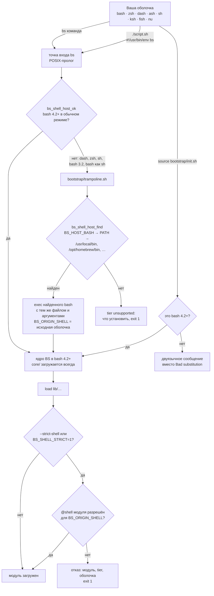
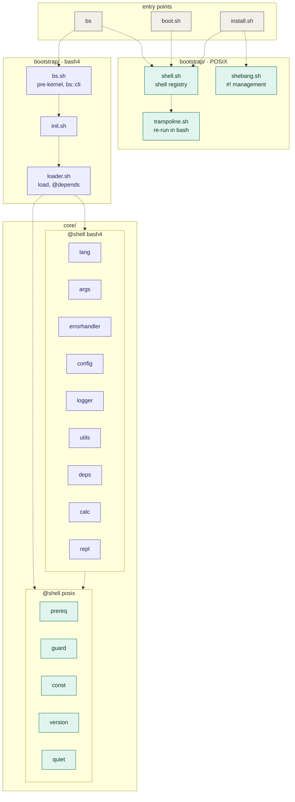
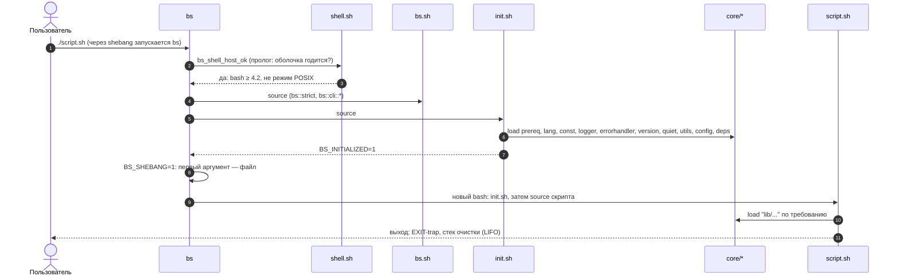
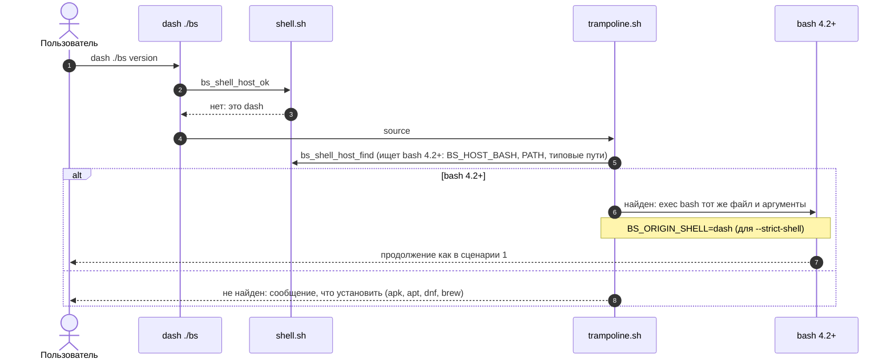
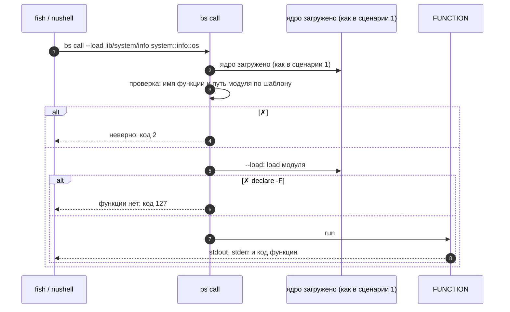
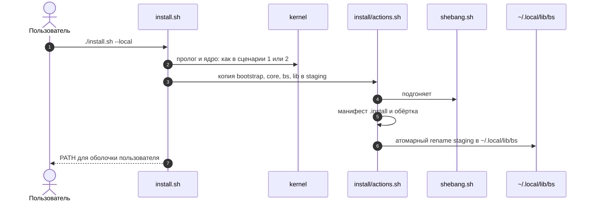
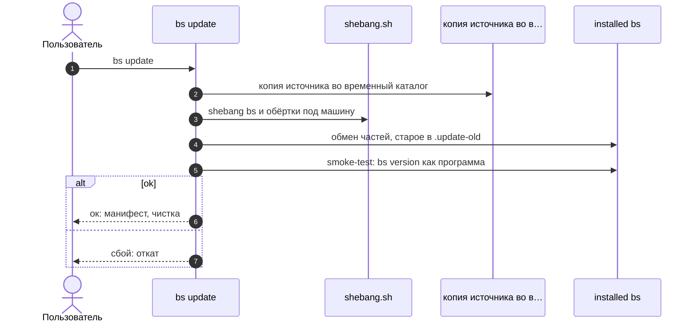

[↑ Оглавление](../README.md)

# Начало работы

## Что такое BS

**BS** — модульный фреймворк и стандартная библиотека на Bash. В его
состав входят загрузчик модулей, логирование, обработка ошибок,
декларативные параметры скриптов, абстракция потоков ввода/вывода и набор
системных модулей — всё в едином стиле кода и без единой внешней
зависимости.

Команду `bs` и скрипты на BS можно запускать из любой оболочки: bash, zsh,
dash, ash/busybox, sh, ksh, fish, nushell. Какой bash исполнит код и что
разрешено вашей оболочке, решает механизм tier — см.
[«Работа из любой оболочки»](#работа-из-любой-оболочки).

## Требования

- **bash 4.2+** где-то в `PATH`: на нём исполняется ядро (ярус `bash4`). Версии
  4.2 и 4.3 допускаются кодом, но CI проверяет с **4.4** (почти все платформы
  поставляют 4.4 и новее).
- Запускать `bs` и `install.sh` можно **из любой оболочки** (dash, ash, zsh, ksh,
  fish, nushell): пролог найдёт bash и перезапустится в нём. Модули `@shell
  posix` подключаются из bash, zsh, dash, ash, ksh, mksh напрямую (см. раздел
  «Как устроено ядро»); fish и nushell вызывают функции ядра через `bs call`.
  Подробнее — [«Работа из любой оболочки»](#работа-из-любой-оболочки).
- Linux (основная платформа; macOS поддерживается частично: системный bash там
  3.2, нужен bash 4.2+ из Homebrew)
- Termux (Android): первую строку скриптов подгоняет
  [`bs shebang`](#shebang-под-эту-машину).

Ничего больше не требуется: BS использует только встроенные команды
оболочки и стандартные системные утилиты.

## Установка

BS работает прямо из репозитория — установка необязательна и нужна только
для того, чтобы команда `bs` оказалась в `PATH`.

### Запуск из репозитория

```bash
git clone <repo-url> bs
cd bs
./bs doctor
```

### Локальная установка (`~/.local`, без sudo)

```bash
./install.sh --local
```

Копирует фреймворк в `~/.local/lib/bs`, создаёт обёртку `~/.local/bin/bs` и
добавляет `~/.local/bin` в `PATH` в rc-файл вашей оболочки (и в уже
существующие `~/.bashrc` / `~/.zshrc`; `--shell NAME` задаёт оболочку явно),
идемпотентно.
Помощники для настройки PATH:

```bash
./install.sh --local --path          # print the export snippet
./install.sh --local --update-path   # add to the rc file of your shell
```

### Системная установка (`/usr/local`, нужен root)

```bash
sudo ./install.sh
```

Файлы попадают в `/usr/local/lib/bs`, обёртка — в `/usr/local/bin/bs`.

Каталоги установки можно переопределить переменными окружения `PREFIX`,
`BIN_DIR` и `LIB_DIR`.

### Удаление

```bash
sudo ./install.sh uninstall      # system
./install.sh --local uninstall   # local
```

> **Примечание про исходный каталог.**  
> Установщик **копирует** файлы BS в целевой каталог
> (`~/.local/lib/bs` при `--local`, `/usr/local/lib/bs` при системной
> установке; пути можно переопределить через `PREFIX`/`LIB_DIR`/`BIN_DIR`)
> и создаёт обёртку `bs` в соответствующем `bin/`. После успешной
> установки исходный репозиторий можно удалить — фреймворк будет
> работать из целевого каталога.

## Проверка установки

```bash
./bs doctor    # framework integrity check
./bs list      # list modules
./bs version   # framework version
./bs version --full   # + where this copy is from
```

- `bs doctor` проверяет наличие `bootstrap/init.sh`, core-модулей и каталогов
  `core/` и `lib/` в `BS_ROOT` и возвращает ненулевой код, если чего-то не
  хватает.
- `bs doctor` также показывает строки `shell (host)` (какой bash исполняет
  BS), `shell (yours)` (ваша оболочка и её tier) и число модулей с
  аннотациями `@shell posix` / `@shell bash4`.
- `bs where` — где лежит эта копия BS, видна ли команда `bs` в `PATH`, и
  раздел «Оболочка»: хозяин, ваша оболочка (login и родительский процесс),
  tier.
- `bs list` выводит модули, лежащие непосредственно в `core/` и `lib/`
  (например, `core/args.sh`, `lib/automation.sh`). Вложенные модули вроде
  `lib/io/streams.sh` находятся в подкаталогах и подключаются по пути.

## Первый скрипт

Рабочая копия: [examples/hello.sh](../../../examples/hello.sh).

```bash
#!/usr/bin/env bs
# shellcheck shell=bash

load "lib/io/streams"

io::streams::print "hello from BS $(bs::version::get)"
```

- `#!/usr/bin/env bs` — запускает скрипт через интерпретатор `bs`; ядро
  фреймворка загружается до вашего кода, bootstrap-бойлерплейт не нужен.
- `# shellcheck shell=bash` — обязательно на строке 2, если shebang — `bs`.
- Строгий режим уже включён интерпретатором (`set -euo pipefail` до source
  вашего скрипта) — строка здесь не нужна. Её ставят только обычные точки
  входа `#!/usr/bin/env bash` — через `utils::strict` (после загрузки ядра)
  или pre-kernel `bs::strict` из `bootstrap/bs.sh`.
- `load "lib/io/streams"` — путь относительно `BS_ROOT`, без `.sh`. Не
  подключайте модули фреймворка через `source` в новых скриптах.
- `io::streams::print` — безопасный вывод: обёртка над `printf '%s\n'`,
  которая не ломается на значениях вроде `-n` или `-e`. Версию отдаёт
  функция ядра `bs::version::get`.

## Запуск скриптов

```bash
./bs run examples/hello.sh
./examples/hello.sh          # когда bs в PATH
```

Примеры со стартовой страницы:

```bash
./bs run examples/hello.sh     # короткий скрипт
./bs run examples/todo.sh      # TUI todo list (lib/tui)
./bs run examples/pulse.sh     # пульс возможностей машины
```

CLI на `core/args` (авто-help, валидация) — в
[туториале «Первый скрипт»](../05-tutorials/first-script.md).

## Работа из любой оболочки

Ядро и `lib/` написаны на bash 4.2+ (массивы, `[[ ]]`, `local -r`), но
запускать BS можно из любой оболочки. Код всегда исполняет найденный на
машине bash, а оболочка, из которой вы пришли, влияет только на настройку
`PATH`, подсказки и — в строгом режиме — на то, какие модули разрешены.

### Три оболочки

| Роль | Что это | Кто определяет |
|---|---|---|
| **хозяин (host)** | интерпретатор, который исполняет код BS | всегда bash 4.2+: тот, что запустил `bs`, либо найденный трамплином (`BS_HOST_BASH` главнее поиска) |
| **ваша оболочка** | где вы набираете команды; её rc-файл получает `PATH` | `BS_USER_SHELL`, иначе родительский процесс, иначе login-оболочка |
| **исходная оболочка** | оболочка, которая первой прочитала файл `bs` | трамплин экспортирует `BS_ORIGIN_SHELL`; без трамплина — `bash` |

### Схема запуска



В bash 4.2+ пролог — одна проверка, ничего не перезапускается. Повторный
заход в трамплин после `exec` считается сбоем и останавливается, поэтому
зациклиться запуск не может. Пошагово эти пути, а также `bs call`, POSIX-ярус
без bash, установка и обновление, — в разделе
[«Как устроено ядро: схемы UML»](#как-устроено-ядро-схемы-uml).

### Tier вашей оболочки

Ответ на вопрос «как BS работает именно у меня»:

| tier | смысл |
|---|---|
| `native` | ваша оболочка — bash 4.2+: работают и команды `bs`, и подключение библиотеки через `source` |
| `hosted` | другая оболочка: BS работает как команда `bs`, код исполняет найденный bash 4.2+; `PATH` и rc-файл настраиваются под вашу оболочку |
| `unsupported` | bash 4.2+ на машине нет: BS не запустится и подскажет, что установить |

Где посмотреть:

```bash
bs where                  # раздел «Оболочка»: хозяин, ваша оболочка, tier
bs doctor                 # строки shell (host) и shell (yours)
bs init-shell --list      # все известные оболочки: tier, rc-файл, перезагрузка
bs init-shell             # что добавить в rc-файл ВАШЕЙ оболочки
```

### Tier модуля: аннотация `@shell`

Каждый файл может объявить, на каком языке оболочки он написан, — строкой
`# @shell` в шапке, с двуязычной причиной после тире:

```bash
# @shell bash4 — нужны массивы и [[ ]] / needs arrays and [[ ]]
```

| tier модуля | разрешён из |
|---|---|
| `posix` | любой оболочки |
| `bash4` (по умолчанию, если аннотации нет) | bash 4.2+ |
| имя оболочки (`zsh`, `fish`, `nu`, …) | только этой оболочки |
| список через запятую (`zsh,bash4`) | любой из перечисленных |

Синонимы: `sh`, `shell`, `posix` = `posix`; `bash`, `bash4` = `bash4`;
`fs`, `fish` = `fish`; `nu`, `nushell` = `nu`.

Эта ось не связана с `@tier core | gnu-linux` — тот описывает нужный модулю
userland (утилиты), а `@shell` — язык файла.

### Строгое указание оболочки

По умолчанию трамплин даёт любой оболочке любой модуль: код всё равно
исполняет bash. Если нужно гарантировать, что скрипт использует только
модули, написанные для оболочки, из которой его запустили, включите строгий
режим:

```bash
dash ./bs --strict-shell run script.sh   # флаг ставится ДО команды
BS_SHELL_STRICT=1 dash ./bs run script.sh
```

Тогда модуль `lib/` загружается, только если его `@shell` разрешён для
исходной оболочки. Отказ называет модуль, его tier и оболочку и завершается
кодом 1:

```text
BS: модуль 'lib/io/streams' (@shell bash4) нельзя исполнять из оболочки 'dash' (--strict-shell)
```

Правила строгого режима:

- `core/` разрешён всегда — без ядра ничего не запустится.
- Исходная оболочка — та, что первой прочитала файл `bs`. bash, который
  дошёл до трамплина (bash 3.2 или bash в режиме POSIX), считается `sh`.
- Скрипт с `#!/usr/bin/env bs`, запущенный как `./script.sh`, всегда
  стартует через `#!/usr/bin/env bash` самого `bs`, поэтому его исходная
  оболочка — `bash`, из какой бы оболочки вы его ни вызвали. Флаг в шебанг
  не передать — используйте `BS_SHELL_STRICT=1`, а проверку по конкретной
  оболочке делайте запуском `<оболочка> ./bs --strict-shell run script.sh`.

### Вызов из fish и nushell: `bs call`

У fish и nushell другой синтаксис, подключить ядро в них нельзя. Функцию ядра
или модуля можно вызвать командой: она исполняется в bash, stdout, stderr и
код выхода — её.

```bash
bs call utils::human_size 1536000                  # 1.5 MiB
bs call --load lib/system/info system::info::os     # с загрузкой модуля
```

Из fish: `set size (bs call utils::human_size 1536000)`. Исполняется только
существующая функция с допустимым именем (иначе код 2 или 127); путь модуля —
только `core/...` или `lib/...`.

### Переменные, которые задают оболочку явно

| Переменная | Что задаёт |
|---|---|
| `BS_HOST_BASH=/path/to/bash` | какой bash берёт трамплин, когда BS запущен не из bash 4.2+; невалидное значение — ошибка, без тихого перехода к поиску |
| `BS_USER_SHELL=zsh` | вашу оболочку: от неё зависят rc-файл, строка `PATH` и tier |
| `BS_SHELL_STRICT=1` | строгий режим, то же, что `--strict-shell` |

### Shebang под эту машину

Шебанг требует абсолютного пути. На большинстве Linux это `/usr/bin/env`, а в
Termux каталога `/usr` нет. Команда `bs shebang` проверяет и переписывает
первую строку скриптов:

```bash
bs shebang info                 # где env на этой машине, какие режимы работают
bs shebang check examples/      # работает ли шебанг каждого файла здесь
bs shebang set --mode auto examples/   # переписать, где нужно
```

Режимы: `portable` (`#!/usr/bin/env bs`, для обмена), `env` (env этой
машины), `abs` (полный путь к `bs`), `auto` (по умолчанию: `portable`, если
есть `/usr/bin/env`, иначе `env`).

Подробности — в [«Переносимость между оболочками»](../08-development/shell-portability.md)
и [«Архитектура»](../02-core-concepts/architecture.md).

## Как устроено ядро: схемы UML

Схемы ниже — в формате [Mermaid](https://mermaid.js.org/) (GitHub рисует их сам). Цвет несёт смысл: **бирюзовый** — ярус `@shell posix` (работает в любой оболочке), **фиолетовый** — ярус `@shell bash4` (нужен bash 4.2+), серый — точки входа. Сначала общая картина, затем шесть сценариев.

### Компоненты



Стрелки — зависимости (кто кого подключает). Файлы `core/` внутри пакета загружает `init.sh`, в порядке сверху вниз.

### Сценарии

#### 1. `bs script.sh` или `#!/usr/bin/env bs` из bash 4.2+



<details>
<summary>Текст диаграммы (Mermaid)</summary>



</details>

#### 2. Запуск из dash, ash или другой оболочки: перезапуск в bash


<details>
<summary>Текст диаграммы (Mermaid)</summary>



</details>

#### 3. Вызов функции ядра из fish или nushell: `bs call`


<details>
<summary>Текст диаграммы (Mermaid)</summary>



</details>

#### 4. POSIX-ярус напрямую, без bash


<details>
<summary>Текст диаграммы (Mermaid)</summary>

```mermaid
sequenceDiagram
  autonumber
  participant D as скрипт на dash: подключает слой
  participant sh as shell.sh
  participant pre as prereq.sh
  participant q as quiet.sh
  D->>sh: . bootstrap/shell.sh
  D->>pre: . core/prereq.sh
  D->>q: . core/quiet.sh
  D->>q: utils_has ls
  q-->>D: код 0 или 1; bash не запускался
```

</details>

#### 5. Установка: `./install.sh --local`



<details>
<summary>Текст диаграммы (Mermaid)</summary>



</details>

#### 6. Обновление: `bs update`



<details>
<summary>Текст диаграммы (Mermaid)</summary>



</details>


## Куда идти дальше

- [Архитектура](../02-core-concepts/architecture.md) — стадии загрузки,
  `BS_ROOT`, загрузчик модулей
- [Модуль core/args](../03-modules/args.md) — деревья параметров, флаги,
  bash completion
- [Модуль lib/io/streams](../03-modules/io-streams.md) — безопасный вывод,
  перенаправления, pipe
- [Туториал: первый скрипт](../05-tutorials/first-script.md) — пошаговое
  руководство

См. также [README репозитория](../../../README.md) и рабочие примеры в
[examples/](../../../examples/).
