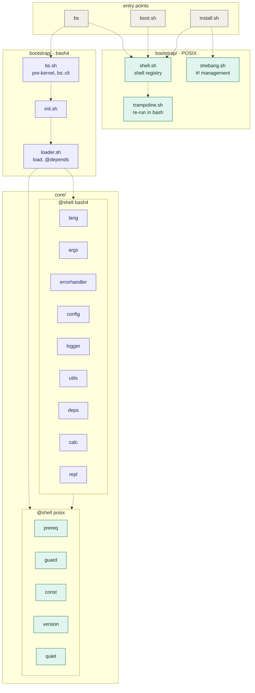
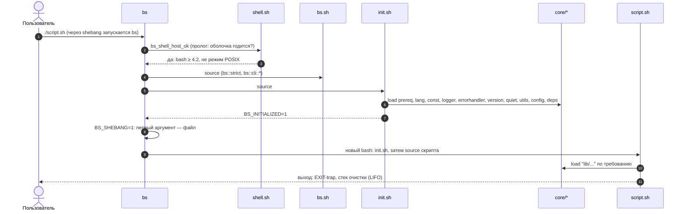
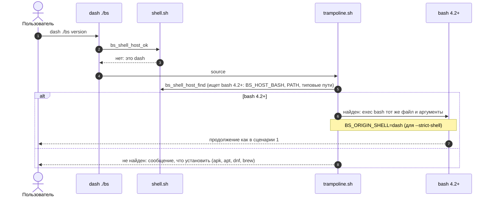
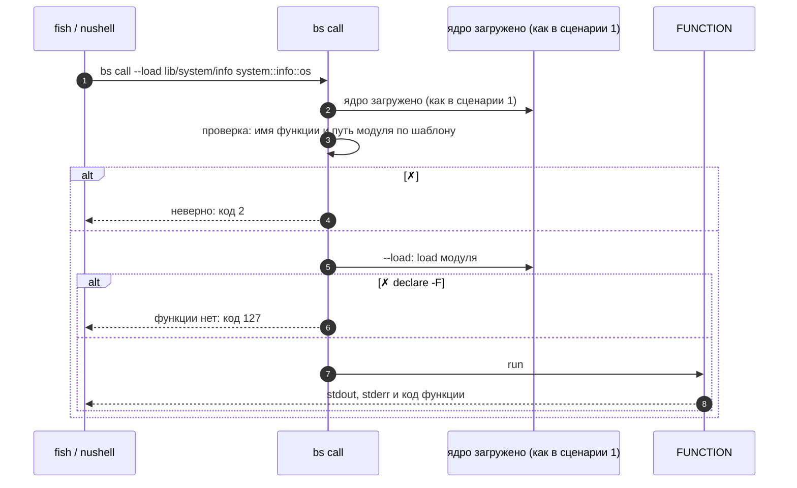
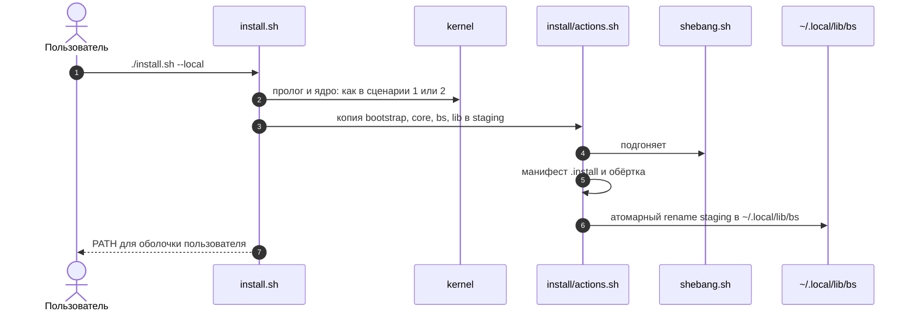
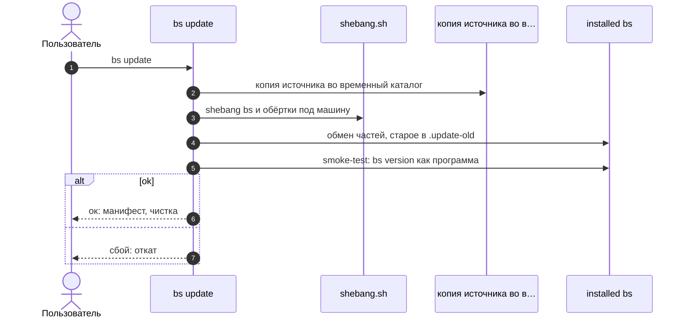

[↑ Оглавление](../README.md)

# Начало работы

## Что такое BS

**BS** — модульный фреймворк и стандартная библиотека на **Bash 4.2+**. В его
состав входят загрузчик модулей, логирование, обработка ошибок,
декларативные параметры скриптов, абстракция потоков ввода/вывода и набор
системных модулей — всё в едином стиле кода и без единой внешней
зависимости.

## Требования

- **bash 4.2+ — обязательное требование.** На bash написаны вся библиотека `lib/`
  (87 модулей) и 6 из 15 файлов ядра `core/`, поэтому без bash BS не работает.
  Версии 4.2 и 4.3 допускаются кодом, но CI проверяет с **4.4** (почти все
  платформы поставляют 4.4 и новее).
- Исключение — 9 файлов ядра с меткой `@shell posix`: они не зависят от bash и
  подключаются из dash, ash, ksh, mksh, zsh и bash (см. раздел «Как устроено
  ядро»). Это небольшой набор помощников (константы, версия, `bs_utils_has`,
  `bs_log_info`, `calc` и др.), а не весь BS.
- Запускать `bs` и `install.sh` можно **из любой оболочки** (dash, ash, zsh, ksh,
  fish, nushell): пролог найдёт bash и перезапустится в нём, так что bash должен
  быть в системе, но не обязан быть вашей оболочкой.
- Linux (основная платформа; macOS поддерживается частично: системный bash там
  3.2, нужен bash 4.2+ из Homebrew)

Ничего больше не требуется: BS использует только встроенные команды bash и
стандартные системные утилиты.

**Курс на независимость от оболочки.** Цель — ядро (`bootstrap/`, `core/`, `install/`,
`boot.sh`, `bs`, `install.sh`) в одном пространстве имён `bs_*`, не зависящее от
оболочки (dash, ash, ksh, mksh, zsh, bash). Уже готово 9 из 15 файлов `core/`
(включая слой массивов и словарей `core/data.sh`) и слой оболочек в `bootstrap/`;
остальное переводится по плану (см. [shell-portability](../08-development/shell-portability.md#курс-на-независимость-от-оболочки)).
Вся библиотека `lib/` пока написана для bash 4.2+ (zsh разбирает 85 из 87 файлов,
но работа `lib/` в zsh не проверялась).

## Установка

BS работает прямо из репозитория — установка необязательна и нужна только
для того, чтобы команда `bs` оказалась в `PATH`.

### Запуск из репозитория

```bash
git clone <repo-url> bs
cd bs
./bs doctor
```

### Локальная установка (`~/.local`, без sudo)

```bash
./install.sh --local
```

Копирует фреймворк в `~/.local/lib/bs`, создаёт обёртку `~/.local/bin/bs` и
добавляет `~/.local/bin` в `PATH` в `~/.bashrc` / `~/.zshrc` (идемпотентно).
Помощники для настройки PATH:

```bash
./install.sh --local --path          # print the export snippet
./install.sh --local --update-path   # add to ~/.bashrc / ~/.zshrc
```

### Системная установка (`/usr/local`, нужен root)

```bash
sudo ./install.sh
```

Файлы попадают в `/usr/local/lib/bs`, обёртка — в `/usr/local/bin/bs`.

Каталоги установки можно переопределить переменными окружения `PREFIX`,
`BIN_DIR` и `LIB_DIR`.

### Удаление

```bash
sudo ./install.sh uninstall      # system
./install.sh --local uninstall   # local
```

> **Примечание про исходный каталог.**  
> Установщик **копирует** файлы BS в целевой каталог
> (`~/.local/lib/bs` при `--local`, `/usr/local/lib/bs` при системной
> установке; пути можно переопределить через `PREFIX`/`LIB_DIR`/`BIN_DIR`)
> и создаёт обёртку `bs` в соответствующем `bin/`. После успешной
> установки исходный репозиторий можно удалить — фреймворк будет
> работать из целевого каталога.

## Проверка установки

```bash
./bs doctor    # framework integrity check
./bs list      # list modules
./bs version   # framework version
./bs version --full   # + where this copy is from
```

- `bs doctor` проверяет наличие `bootstrap/init.sh`, core-модулей и каталогов
  `core/` и `lib/` в `BS_ROOT` и возвращает ненулевой код, если чего-то не
  хватает.
- `bs list` выводит модули, лежащие непосредственно в `core/` и `lib/`
  (например, `core/args.sh`, `lib/automation.sh`). Вложенные модули вроде
  `lib/io/streams.sh` находятся в подкаталогах и подключаются по пути.

## Первый скрипт

Рабочая копия: [examples/hello.sh](../../../examples/hello.sh).

```bash
#!/usr/bin/env bs
# shellcheck shell=bash

load "lib/io/streams"

io::streams::print "hello from BS $(bs::version::get)"
```

- `#!/usr/bin/env bs` — запускает скрипт через интерпретатор `bs`; ядро
  фреймворка загружается до вашего кода, bootstrap-бойлерплейт не нужен.
- `# shellcheck shell=bash` — обязательно на строке 2, если shebang — `bs`.
- Строгий режим уже включён интерпретатором (`set -euo pipefail` до source
  вашего скрипта) — строка здесь не нужна. Её ставят только обычные точки
  входа `#!/usr/bin/env bash` — через `utils::strict` (после загрузки ядра)
  или pre-kernel `bs::strict` из `bootstrap/bs.sh`.
- `load "lib/io/streams"` — путь относительно `BS_ROOT`, без `.sh`. Не
  подключайте модули фреймворка через `source` в новых скриптах.
- `io::streams::print` — безопасный вывод: обёртка над `printf '%s\n'`,
  которая не ломается на значениях вроде `-n` или `-e`. Версию отдаёт
  функция ядра `bs::version::get`.

## Запуск скриптов

```bash
./bs run examples/hello.sh
./examples/hello.sh          # когда bs в PATH
```

Примеры со стартовой страницы:

```bash
./bs run examples/hello.sh     # короткий скрипт
./bs run examples/todo.sh      # TUI todo list (lib/tui)
./bs run examples/pulse.sh     # пульс возможностей машины
```

CLI на `core/args` (авто-help, валидация) — в
[туториале «Первый скрипт»](../05-tutorials/first-script.md).

## Как устроено ядро: схемы UML

Схемы ниже — в формате [Mermaid](https://mermaid.js.org/) (GitHub рисует их сам). Цвет несёт смысл: **бирюзовый** — ярус `@shell posix` (работает в любой оболочке), **фиолетовый** — ярус `@shell bash4` (нужен bash 4.2+), серый — точки входа. Сначала общая картина, затем шесть сценариев.

### Компоненты



Стрелки — зависимости (кто кого подключает). Файлы `core/` внутри пакета загружает `init.sh`, в порядке сверху вниз.

### Сценарии

#### 1. `bs script.sh` или `#!/usr/bin/env bs` из bash 4.2+


<details>
<summary>Текст диаграммы (Mermaid)</summary>



</details>

#### 2. Запуск из dash, ash или другой оболочки: перезапуск в bash


<details>
<summary>Текст диаграммы (Mermaid)</summary>



</details>

#### 3. Вызов функции ядра из fish или nushell: `bs call`


<details>
<summary>Текст диаграммы (Mermaid)</summary>



</details>

#### 4. POSIX-ярус напрямую, без bash


<details>
<summary>Текст диаграммы (Mermaid)</summary>

```mermaid
sequenceDiagram
  autonumber
  participant D as скрипт на dash: подключает слой
  participant sh as shell.sh
  participant pre as prereq.sh
  participant q as quiet.sh
  D->>sh: . bootstrap/shell.sh
  D->>pre: . core/prereq.sh
  D->>q: . core/quiet.sh
  D->>q: bs_utils_has ls
  q-->>D: код 0 или 1; bash не запускался
```

</details>

#### 5. Установка: `./install.sh --local`


<details>
<summary>Текст диаграммы (Mermaid)</summary>



</details>

#### 6. Обновление: `bs update`


<details>
<summary>Текст диаграммы (Mermaid)</summary>



</details>


## Куда идти дальше

- [Архитектура](../02-core-concepts/architecture.md) — стадии загрузки,
  `BS_ROOT`, загрузчик модулей
- [Модуль core/args](../03-modules/args.md) — деревья параметров, флаги,
  bash completion
- [Модуль lib/io/streams](../03-modules/io-streams.md) — безопасный вывод,
  перенаправления, pipe
- [Туториал: первый скрипт](../05-tutorials/first-script.md) — пошаговое
  руководство

См. также [README репозитория](../../../README.md) и рабочие примеры в
[examples/](../../../examples/).
