[↑ Руководство разработчика](README.md)

# Переносимость между оболочками

BS должен работать из большинства оболочек, а не только из bash и zsh. Эта
страница — дизайн ветки `fix/kernel-security-p0`; рабочие правила для авторов
— в скилле `.agents/skills/bs-shell-portability/SKILL.md`.

## Три оболочки, а не одна

| Роль | Смысл | Кто определяет |
|---|---|---|
| **host** | интерпретатор, исполняющий код BS | всегда bash ≥ 4.2 (находит трамплин) |
| **оболочка пользователя** | где человек набирает команды; чей rc-файл получает PATH | `--shell`, `BS_USER_SHELL`, родительский процесс, логин-оболочка |
| **оболочка скрипта** | шебанг пользовательского скрипта (`#!/usr/bin/env bs`) | скрипт |

Ядру и `lib/` нужны массивы, namerefs, `[[ ]]`, `local -r`; они остаются
bash. От оболочки освобождено всё *вокруг*: точки входа, установщик, настройка
PATH, проверки, удаление, `bs where`.

## Режимы доступа

- **exec** — `bs ...` из любой оболочки. Точка входа начинается с
  POSIX-пролога; если интерпретатор — не bash ≥ 4 (или bash в режиме POSIX),
  подключается `bootstrap/trampoline.sh`: он находит подходящий bash и делает
  `exec` того же файла с теми же аргументами.
- **source** — `source bootstrap/init.sh`. Только bash 4.2+. В других
  оболочках — двуязычное сообщение вместо `Bad substitution`.
- **call** — `bs call [--load МОДУЛЬ] ФУНКЦИЯ [АРГУМЕНТЫ]`: мост для оболочек с
  другим синтаксисом (fish, nushell, dash, ash, ksh). Функция ядра или модуля
  исполняется в bash, который запускает `bs`; её stdout и stderr — ваши, код
  выхода функции становится кодом `bs call`. Исполняется только существующая
  функция с допустимым именем (`rm`, `a;b`, `$(id)` отвергаются), путь модуля —
  только `core/...` или `lib/...` без `..`. Пример: `bs call utils::human_size
  1536000`; из fish: `set size (bs call utils::human_size 1536000)`.
- **trampoline** — механизм первого режима. `BS_HOST_BASH=/path`
  переопределяет поиск (невалидное значение — ошибка, без тихого fallback).
  Если bash 4.2+ нет — подсказки по установке (apk/apt/dnf/brew) и код 1.

## Tier-ы

Две независимые оси:

- `@tier core | gnu-linux` — какой *userland* нужен модулю (без изменений).
- `@shell posix | bash4` — на каком *языке* написан файл. Отсутствие = `bash4`.
  После тире — двуязычная причина:
  `# @shell bash4 — используются массивы и [[ ]]`.

Итог для пользователя — `platform::get shell_tier`:

| tier | смысл |
|---|---|
| `native` | оболочка пользователя — bash 4.2+; BS можно подключать через source |
| `hosted` | другая оболочка; BS работает командой `bs`, исполняемой найденным bash |
| `unsupported` | на машине нет bash 4.2+ |

Неустранимая зависимость не скрывается: модуль помечен `bash4` и объясняет
причину в аннотации.

## Реестр оболочек — `bootstrap/shell.sh`

POSIX-код. Функции называются `bs_shell_*` (dash не принимает `::` в именах);
алиасы `bs::shell::*` создаются через `eval` только в bash/zsh. Знает семейства
`bash zsh dash ash sh ksh mksh oksh osh fish nu` и отвечает: `family`, `user`,
`rc_file`, `path_line`, `reload_hint`, `fresh_flags`, `all_rc_files`,
`host_find`, `tier`, `tier_desc`.

| оболочка | rc-файл | строка PATH |
|---|---|---|
| bash | `~/.bashrc` | `export PATH="$HOME/.local/bin:$PATH"` |
| zsh | `${ZDOTDIR:-~}/.zshrc` | та же |
| dash, ash, sh, ksh, mksh, oksh | `~/.profile` | та же |
| osh | `~/.config/oils/oshrc` | та же |
| fish | `~/.config/fish/conf.d/bs.fish` | `contains -- … $PATH; or set -gx PATH …` |
| nu | `~/.config/nushell/env.nu` | `$env.PATH = ($env.PATH \| prepend …)` |

nushell: если `env.nu` нет, установщик его не создаёт, а печатает точную
строку для добавления.

## Строгий режим — `bs --strict-shell`

По умолчанию трамплин даёт любой оболочке любой модуль (код всегда исполняется
в bash). `--strict-shell` (или `BS_SHELL_STRICT=1`, нужен для shebang-режима)
делает tier `@shell` обязательным: модуль `lib/` загружается, только если его
tier подходит оболочке, из которой BS **запущен** (`BS_ORIGIN_SHELL`, её
экспортирует трамплин; bash, дошедший до трамплина, считается `sh`).

| tier модуля | разрешён из |
|---|---|
| `posix` | любой оболочки |
| `bash4` (по умолчанию) | bash 4.2+ |
| другое слово (`zsh`, `fish`, `nu`, …) | оболочки с этим именем |
| список `zsh,bash4` | любой из них |

Синонимы (слова tier и имена оболочек): `sh`, `shell`, `posix` = `posix`; `bash`, `bash4` = `bash4`; `fs`, `fish` = `fish`; `nu`, `nushell` = `nu`. Неизвестное слово остаётся как есть.

`core/` (ядро) разрешено всегда, иначе ничего не запустится. Отказ называет
модуль, его tier и исходную оболочку и завершается кодом 1:

```bash
dash ./bs --strict-shell run script.sh   # модуль lib/io/streams (@shell bash4) нельзя исполнять из 'dash'
```

## Где можно проверять оболочку

Только в слое абстракции: `bootstrap/bs.sh`, `bootstrap/shell.sh`, `bootstrap/trampoline.sh`. Везде в другом месте прямое использование `BASH_SOURCE`, `BASH_VERSION`, `FUNCNAME`, `ZSH_*`, `$SHELL`, `$0` как пути должно либо звать слой (`bs::is_main`, `bs::script_dir`, `bs::func_name`, `bs::stack_*`, `bs_shell_host_ok`), либо нести тег `shell-gate` с причиной. Проверяет `.agents/skills/bs-shell-abstraction/scripts/find_leaks.sh`; у точек входа один общий пролог, каталог они берут из `BS_ENTRY_DIR` / `BS_BOOTSTRAP_DIR`.

Помимо определения, слой даёт: `bs::shell::host` (запущенный bash: дочерние оболочки стартуют как `"$(bs::shell::host)" -c`, не голым `bash`), вопросы к реестру вместо сравнений семейства (`bs_shell_can_source`, `bs_shell_rc_create_ok`, `bs_shell_default_login_path`) и `args::completion PROG [bash|zsh|fish|nu]` (zsh проверен в настоящем zsh; fish и nushell — только как текст).

## Приоритеты оболочек

Приоритет считается по двум вещам: **где оболочка встречается** (оценка по
дистрибутивам и платформам, не измерение) и **что реально проверено на
этой машине** (Fedora 43; команды `./bs version`, скрипт с `#!/usr/bin/env bs`,
`install.sh --help`, `bs init-shell`, `probe_shells.sh`). Таблицу пополняйте
только результатами настоящих запусков.

| # | Оболочка | Где встречается | Версия здесь | Запуск `bs` и скрипта | Родное ядро (`bash4`) | Что делать |
|---|---|---|---|---|---|---|
| 1 | bash | почти все Linux, Termux, WSL; macOS — старый 3.2 | 5.3.0 | да | да | хозяин ядра; эталон |
| 1 | zsh | macOS по умолчанию, много Linux-разработчиков | 5.9 | да | парсится, ведёт себя иначе (массивы с 1, нет `FUNCNAME`, `BASH_REMATCH`) | слой совместимости, дополнения |
| 2 | dash | `/bin/sh` в Debian/Ubuntu, скрипты установки | 0.5.12 | да (трамплин) | нет | POSIX-ядро (`core/`) |
| 2 | busybox ash | Alpine, контейнеры, роутеры, Termux | 1.37.0 | да (трамплин) | нет; терпимее dash (`[[ ]]`, `pipefail`, `::`) | POSIX-ядро, проверка в Termux |
| 3 | fish | популярная интерактивная оболочка | 4.2.0 | да, только как команда `bs` и скрипт с shebang | не применимо (другой синтаксис) | мост (`bs call`), текст дополнений |
| 3 | ksh93 | Unix, BSD, корпоративные системы | 93u+m 1.0.10 | да | парсится; нет `local`, `local -r`, `::` | POSIX-ядро; ядро bash4 не обещаем |
| 3 | mksh | **системная оболочка Android**, OpenBSD (форк) | R59 | да | парсится не полностью | POSIX-ядро |
| 4 | nushell | растёт, разработчики | не установлен | не проверено | не применимо | мост, проверка после установки |
| 4 | oksh, osh | редкие | не установлены | не проверено | — | не развивать |

Что значит «да» в колонке запуска: `./bs version` через эту оболочку и скрипт с
`#!/usr/bin/env bs` отработали; `install.sh --help` показал справку.
Отдельное «нет» ядра bash4 — не ошибка: ядро запускается в найденном bash
(трамплин), а другим оболочкам даются POSIX-модули и мост.

Порядок разработки: **1 → 2 → 3 → 4**. Внутри уровня 2–3 главный вклад —
расширение POSIX-ядра (см. «POSIX-модули ядра») и мост для оболочек с другим
синтаксисом.

## Что проверено

Реально запускалось на этой машине: bash 5.3.0, zsh 5.9, dash 0.5.12, busybox
ash 1.37.0, ksh93u+m 1.0.10, mksh R59, fish 4.2.0 — запуск `bs version`, скрипт с
shebang `bs`, `install.sh --help`, проба возможностей. **Не запускалось:**
nushell (не установлен), oksh, osh. Для fish проверен только вызов команды
`bs` и скрипта с shebang; его синтаксис ядро не читает.

## Схемы доступа: перезапуск, мост, POSIX-ярус

Три способа добраться до ядра из других оболочек. Полная картина — в [Начале работы](../01-getting-started/README.md).

### Запуск из dash: перезапуск в bash



### Вызов из fish и nushell: `bs call`



### POSIX-ярус без bash



## Тесты и инструменты

- `tests/unit/testshellunit.sh` — реестр; `testtrampolineunit.sh` — точки входа
  под dash/zsh/bash как sh; `testshelltierunit.sh` — аннотации;
  `tests/integration/testinstallshells.sh` — установщик по оболочкам.
- `bash .agents/skills/bs-shell-portability/scripts/tier_scan.sh --check <пути>`
  — аннотация против реальных конструкций.
- `bash .agents/skills/bs-shell-portability/scripts/probe_shells.sh` — проба
  возможностей установленных оболочек.

## POSIX-модули ядра

Файлы `core/` с меткой `@shell posix` переводятся по одному (порядок: `prereq`,
`guard`, `const`, `version`, `logger`, ...). Такой модуль следует контракту
реестра: настоящие функции имеют допустимые идентификаторы (`bs_guard`,
`bs_source_relative`), имена вида `bs::guard` — псевдонимы, которые
`bs_shell_alias` создаёт только в bash и zsh, поэтому все прежние вызовы
работают. Помощники слоя для этих модулей: `bs_shell_alias`,
`bs_shell_readonly` (глобальный `readonly`: в zsh `readonly` внутри функции
локален, поэтому у zsh `readonly -g`). Каталог подключаемого файла берётся из
`BS_CURRENT_FILE`, который загрузчик ставит на время подключения модуля; bash
дополнительно читает его из стека вызовов.
`core/const.sh` показывает ветки по оболочкам: байты ESC берутся из `printf` (без `$'\033'`),
`SUPPORTED_DISTROS` — массив в bash и zsh и строка через пробел там, где массивов нет;
имена `const::*` — псевдонимы `const_*`.

`core/quiet.sh` (`@shell posix`) — идиомы «тишины»: `utils_has`, `utils_quiet`,
`utils_quiet_err`, `utils_ignore`, `utils_attempt` (в bash и zsh — прежние
`utils::*`). Загружается перед `core/utils.sh`; проверен в bash, zsh, dash,
busybox ash, ksh93 и mksh (`unit/testquietportableunit.sh`).

## Не сделано

Автодополнение для fish и nushell `args::completion` генерирует, но в
настоящих fish/nu оно ещё не запускалось; аннотации `@shell` покрывают `core/`
и почти весь `lib/` (файл без аннотации считается `bash4`).
